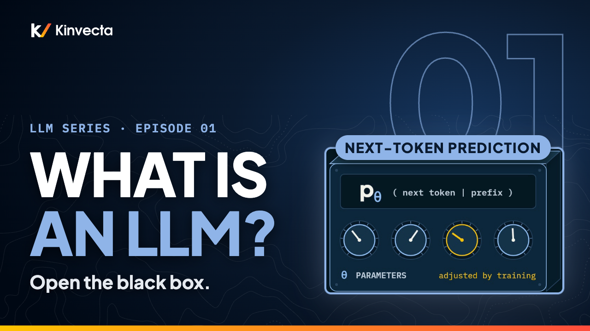

# Episode 1 · What an LLM Really Is

[](https://youtu.be/ZJ4BbrnXBRo) [](https://colab.research.google.com/github/Kinvecta/how-llms-work/blob/main/Episode%2001%20-%20What%20an%20LLM%20Really%20Is/notebook.ipynb) [](slides.pdf) [](research-brief.md) [](transcript/Episode%2001%20-%20What%20an%20LLM%20Really%20Is%20-%20transcript.txt)

<a href="https://youtu.be/ZJ4BbrnXBRo"></a>

**Length:** 12:20 · **Part I:** Foundations · **Math:** one equation · **Code:** GPT-2 small, runs on a CPU

I gave a small language model five words, "The cat sat on the", and asked what comes next. It didn't answer with a word. It answered with a probability for every one of its 50,257 tokens, and "mat" came in at rank 31. Episode 1 opens the box: what an LLM is on your disk, the one equation it computes, the loop that turns probabilities into text, how the dials get set, and what the evidence says about three common claims.

## What you'll learn

- An LLM, literally: a file of learned parameters (θ) plus a small program that runs them
- Tokens, and the vocabulary V
- The one equation: p<sub>θ</sub>(x<sub>t</sub> | x<sub>&lt;t</sub>)
- Generation as a loop: predict, pick, append, repeat
- Pretraining, post-training, a newer reasoning stage, and inference
- Three claims checked against the evidence: Othello-GPT, the taxi map, and the "stochastic parrot"

## The idea in one picture

<table>
<tr>
<td width="50%" valign="top" align="center">

<br><sub>One prediction is a probability for every token. "Mat" is rank 31.</sub>
</td>
<td width="50%" valign="top" align="center">

<br><sub>Generation is that one equation in a loop.</sub>
</td>
</tr>
</table>

## Key ideas

- An LLM is a function. In goes the text so far; out comes a probability for every possible next token. The parameters θ are the dials inside the function: training set them, and using the model only reads them.
- Everything the model "knows" is in the numbers, not the code. Llama 2 70B is about 140 GB of parameters and roughly 500 lines of C.
- The model sees tokens, not words. Our sentence is 11 GPT-2 tokens, the final period included, drawn from a vocabulary of 50,257.
- Each time the prefix grows by one token, the whole distribution is computed again from scratch.
- Prediction is the objective; capability is what the objective rewards. To predict text well you need grammar, facts, the thread of a story, and the shape of questions and answers.
- The evidence cuts both ways. Othello-GPT built a board it was never shown; the taxi models predicted turns perfectly from a map that doesn't exist. Fluency is not proof of thinking, and it is not proof of nothing either.

## Key terms

| Term | Meaning |
|---|---|
| Large language model (LLM) | A learned function from the text so far to a probability for every possible next token, plus the code that runs it |
| Parameters, θ | The learned numbers inside the model (the "dials"). Set by training, fixed while you use the model |
| Token | A chunk of text, usually a word or part of a word, often with its leading space |
| Vocabulary, V | Every token the model can output. 50,257 for GPT-2 |
| Prefix, x<sub>&lt;t</sub> | Every token before position t |
| p<sub>θ</sub>(x<sub>t</sub> \| x<sub>&lt;t</sub>) | The model's probability for the next token, given the prefix |
| Sampling, x<sub>t</sub> ~ p<sub>θ</sub> | Drawing the next token at random in proportion to its probability |
| Greedy decoding | Always picking the most likely token |
| Pretraining | Learning next-token prediction on a very large corpus; the text supplies its own answers |
| Post-training | Adapting a pretrained model to follow instructions, for example with human-written and human-ranked answers |
| Inference | Running the trained model to generate text |

## Run the notebook

The [companion notebook](notebook.ipynb) loads GPT-2 small and reproduces every number in the episode, with an `assert` on each one. In Colab choose *Runtime → Run all*; it takes about a minute on a CPU.

| Step | What it shows | Matches the video |
|:--:|---|---|
| 1 | Parameter count and file size | 124M parameters; 70B × 2 bytes = 140 GB |
| 2 | Tokenize the running sentence | 11 tokens, V = 50,257 |
| 3 | Next-token probabilities, with a chart | floor 7.6%, "mat" rank 31 at 0.40% |
| 4 | The prefix grows | on 22%, the 45%, it 22%, was 32% |
| 5 | The generation loop, by hand | "The cat sat on the floor, and the cat was still asleep." |
| 6 | Random draws from the same prompt | different text each seed |
| 7 | A whole sentence by the chain rule | about 10⁻¹⁷ |

Or run it locally:

```bash
git clone https://github.com/Kinvecta/how-llms-work.git
cd how-llms-work
python3 -m venv .venv && source .venv/bin/activate
pip install -r requirements.txt
python tools/check_notebooks.py "Episode 01 - What an LLM Really Is/notebook.ipynb"
# PASS  Episode 01 - What an LLM Really Is/notebook.ipynb
```

## Try it

About 15 minutes.

1. In the notebook's last cell, change the prompt to something you know the answer to ("The capital of Texas is"). Where does the right answer rank? What does that tell you about a 2019 model with 124M parameters?
2. Change the seed in Step 6 five times. How many different second words do you get after "The cat sat on the"?
3. Pick any sentence and run Step 7 on it. Which single token has the lowest probability, and why might that be?

## Check your understanding

1. What exactly does an LLM output at each step?
2. Where does a model's "knowledge" live: in the code or in the parameters?
3. Why does "mat" come back at rank 31 instead of rank 1, and what does that say about the "database" claim?
4. What changes between greedy decoding and sampling?
5. What did the Othello probe find, and what did the taxi study find?
6. If a model is trained only to predict the next token, why might it still learn to answer questions?

<details><summary>Answers</summary>

1. A probability for every token in its vocabulary (50,257 numbers for GPT-2), given the prefix. Generation then picks one.
2. In the parameters. The code that runs them is small (about 500 lines of C for Llama 2).
3. The model computes a distribution from patterns it learned; it does not retrieve stored sentences. If the sentence were looked up, "mat" would come back first.
4. Greedy always takes the top token, so the output is the same every time. Sampling draws in proportion to the probabilities, so it varies.
5. Othello: the board state can be read from the model's activations (1.7% error against about 26% for an untrained network), although it was trained only on move lists. Taxi: next-turn prediction was near perfect, but the implied map was incoherent and broke under small detours.
6. Text is full of questions followed by answers. The cheapest way to predict what follows a question, across millions of them, is to learn the structure that produces good answers.

</details>

## Further reading

- The [research brief](research-brief.md) for this episode, with every source
- Karpathy, "Intro to Large Language Models" (2023)
- [Transformer Explainer](https://poloclub.github.io/transformer-explainer/): GPT-2 small in your browser
- Jurafsky and Martin, *Speech and Language Processing*, 3rd edition draft, chapters on n-grams and transformers

---

**Next:** [Episode 2, Numbers as Geometry: Vectors](../Episode%2002%20-%20Numbers%20as%20Geometry%20Vectors/): the word "cat" as a list of numbers, and why "close in space" can mean "similar in meaning."

[← Back to the course](../README.md)
