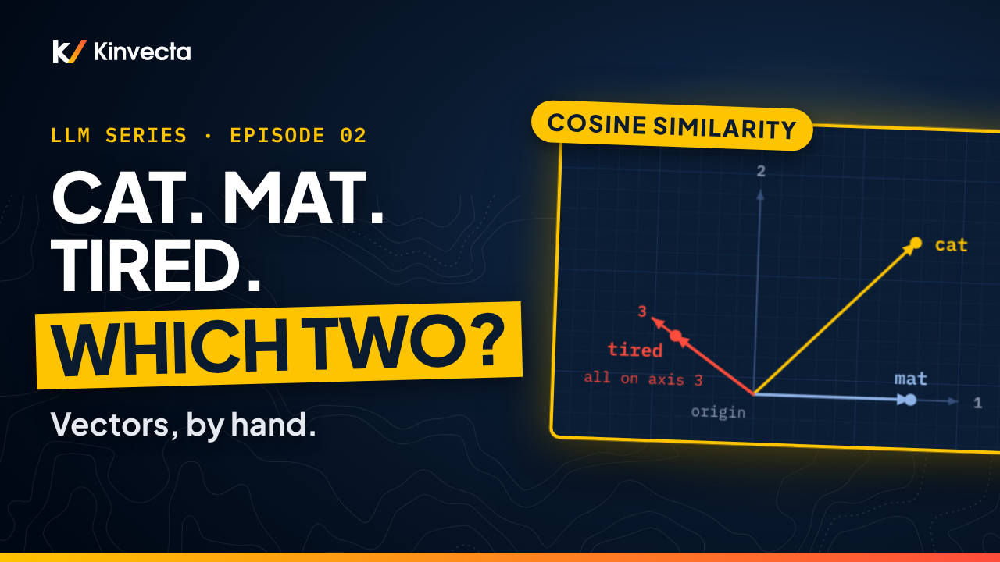

# Episode 2 · Numbers as Geometry: Vectors

[](https://youtu.be/onxRHQlY-TI) [](https://colab.research.google.com/github/Kinvecta/how-llms-work/blob/main/Episode%2002%20-%20Numbers%20as%20Geometry%20Vectors/notebook.ipynb) [](slides.pdf) [](research-brief.md) [](transcript/Episode%2002%20-%20Numbers%20as%20Geometry%20Vectors%20-%20transcript.txt)

<a href="https://youtu.be/onxRHQlY-TI"></a>

**Length:** 13:05 · **Part I:** Foundations · **Math:** three formulas · **Code:** NumPy only, runs anywhere

Three words: cat, mat, tired. Which two are more alike? You can answer that. A language model can't look it up: it has a list of numbers for every word and one calculation that turns two lists into a single score. Episode 2 does that calculation by hand, says exactly what it measures, and shows the two places where it quietly misleads you.

## What you'll learn

- What a vector is, and what its dimension d counts: a list, a point, an arrow
- The dot product, a · b = Σᵢ aᵢbᵢ, and its geometric reading a · b = ‖a‖ ‖b‖ cos φ
- The norm, ‖a‖ = √(a · a)
- Cosine similarity, cos φ = a · b / (‖a‖ ‖b‖), and the scaling test that shows why we divide
- Where learned vectors come from: the distributional hypothesis (Harris, 1954)
- king − man + woman ≈ queen (Mikolov, Yih and Zweig, 2013), and two critiques of the test
- Why cosine can read two random words as nearly identical in GPT-2 (Ethayarajh, 2019; Timkey and van Schijndel, 2021)

## Key ideas

- A vector is an ordered list of numbers. The same list is a point (where the word lives) and an arrow from the origin (which way it points).
- The dot product multiplies matching entries and adds. Geometrically it is the shadow one arrow casts on the other, times that arrow's length: positive when they lean the same way, zero when perpendicular, negative when opposed.
- The norm is a vector's length, and the dot product gives it for free: ‖a‖ = √(a · a).
- Cosine similarity divides the lengths out and keeps only direction. Triple a vector and its dot products triple, but its cosines do not move. That is why cosine, not the raw dot product, became the standard "how alike" score.
- Similar contexts tend to produce similar vectors. That is where the analogy result comes from, and it is a pattern, not a law.
- Cosine is a proxy with known failure modes. In GPT-2's last layer a few rogue dimensions dominate it, and two random words come out nearly identical. Treat a high score as a lead, not a verdict.

## The toy vectors

Hand-built for the episode (axes named by the narrator: 1 = concrete thing, 2 = living, 3 = feeling or state). They are teaching values, not learned ones.

| Word | Vector | ‖·‖ | · mat | cos with mat |
|---|---|---|---|---|
| cat | (1, 1, 0) | √2 ≈ 1.41 | 1 | 0.71 (45°) |
| mat | (1, 0, 0) | 1 | 1 | 1 |
| tired | (0, 0, 1) | 1 | 0 | 0 (90°) |
| cat′ | (3, 3, 0) | 3√2 ≈ 4.24 | 3 | 0.71 (unchanged) |

## Key terms

| Term | Meaning |
|---|---|
| Vector, a | An ordered list of numbers; also a point, or an arrow from the origin |
| Dimension, d | How many numbers the vector has (3 here; 768 in BERT and GPT-2) |
| Component, aᵢ | The i-th number in the list |
| Dot product, a · b | Σᵢ aᵢbᵢ: multiply matching entries, add. Equals ‖a‖ ‖b‖ cos φ |
| Norm, ‖a‖ | The vector's length, √(a · a) |
| Angle, φ | The angle between two vectors (θ is reserved for model parameters) |
| Cosine similarity, cos φ | a · b / (‖a‖ ‖b‖): between −1 and 1, independent of length |
| Projection | How far one vector reaches along another; the "shadow" in the sun picture |
| Distributional hypothesis | Words that occur in similar contexts tend to have similar meanings (Harris, 1954) |
| Vector offset | The analogy method: woman − man + king, then the word with the highest cosine |
| Rogue dimensions | A few coordinates so large that they dominate cosine similarity (Timkey and van Schijndel, 2021) |

## Run the notebook

The [companion notebook](notebook.ipynb) builds the toy vectors in NumPy and reproduces every number in the episode, with an `assert` on each one. It needs no model download and runs in a few seconds.

| Step | What it shows | Matches the video |
|:--:|---|---|
| 1 | Dot products | cat · mat = 1, cat · tired = 0 |
| 2 | Norms | ‖cat‖ = √2 ≈ 1.41, ‖mat‖ = ‖tired‖ = 1 |
| 3 | Cosines and angles | 0.71 and 45°; 0 and 90° |
| 4 | The scaling check | cat′ · mat = 3; cos φ stays 0.71 |
| 5 | Check question | the answer, computed |
| 6 | Try your own | type any three vectors |

Or run it locally:

```bash
git clone https://github.com/Kinvecta/how-llms-work.git
cd how-llms-work
python3 -m venv .venv && source .venv/bin/activate
pip install -r requirements.txt
python tools/check_notebooks.py "Episode 02 - Numbers as Geometry Vectors/notebook.ipynb"
# PASS  Episode 02 - Numbers as Geometry Vectors/notebook.ipynb
```

## Try it

About 15 minutes.

1. Do the three dot products from the episode on paper, with no calculator, then check them against Step 1.
2. In the notebook, change one axis of cat (for example cat = (1, 0, 0.5)). Which numbers move, and which don't?
3. Find two words you would call unrelated and give them vectors that still score a high cosine. It is easier than it should be; that is the lesson of the myth check.

## Check your understanding

1. What are the two ways to read the list (1, 1, 0)?
2. What does the sign of a dot product tell you?
3. Why does cosine similarity ignore the length of the vectors, and when would length still matter?
4. Which pair has the larger cosine, cat–mat or cat–tired? If cat becomes cat′ = (3, 3, 0), which changes: the dot product with mat, or the cosine?
5. What assumption does the king − man + woman method rest on?
6. Why can two random words have an almost perfect cosine in GPT-2's last layer?

<details><summary>Answers</summary>

1. As a point (one step along axis 1, one along axis 2, none along axis 3) and as an arrow from the origin to that point.
2. Positive: the vectors lean the same way. Zero: perpendicular. Negative: they point against each other.
3. The formula divides by ‖a‖ ‖b‖, so scaling either vector cancels out. Length matters whenever the raw dot product is the score, as in attention (Episode 17).
4. cat–mat (0.71 against 0). The dot product with mat changes from 1 to 3; the cosine stays at 0.71.
5. That every pair of words sharing a relation (male → female, say) is separated by roughly the same offset vector.
6. A small number of rogue dimensions, often one to three of 768, are so large that they dominate the cosine, so unrelated words look nearly identical (Timkey and van Schijndel, 2021).

</details>

## Further reading

- The [research brief](research-brief.md) for this episode, with every source
- 3Blue1Brown, "Dot products and duality," *Essence of linear algebra* (2016)
- Mikolov, Chen, Corrado and Dean, "Efficient Estimation of Word Representations in Vector Space" (2013)
- Mikolov, Yih and Zweig, "Linguistic Regularities in Continuous Space Word Representations" (NAACL 2013)
- Timkey and van Schijndel, "All Bark and No Bite: Rogue Dimensions in Transformer Language Models" (2021)

---

**Next:** [Episode 3, Matrices as Machines](../Episode%2003%20-%20Matrices%20as%20Machines/): stack the word vectors into a table, and the table becomes a machine.

[← Back to the course](../README.md)
