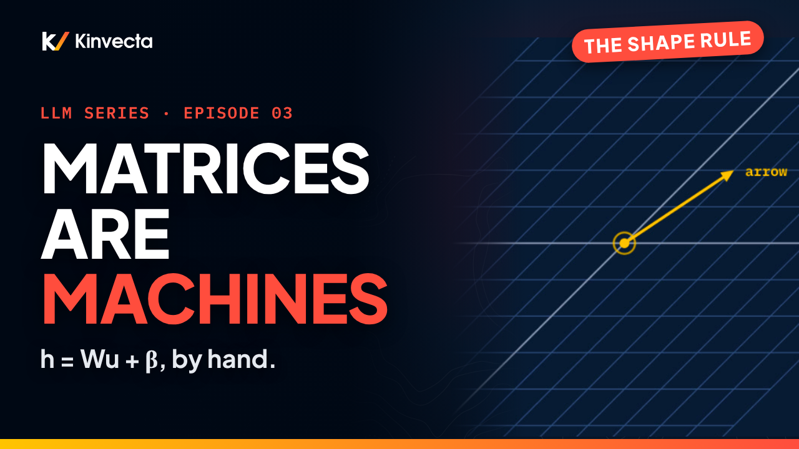

# Episode 3 · Matrices as Machines

[](https://youtu.be/RwVAxe58lqE) [](https://colab.research.google.com/github/Kinvecta/how-llms-work/blob/main/Episode%2003%20-%20Matrices%20as%20Machines/notebook.ipynb) [](slides.pdf) [](research-brief.md) [](transcript/Episode%2003%20-%20Matrices%20as%20Machines%20-%20transcript.txt)

<a href="https://youtu.be/RwVAxe58lqE"></a>

**Length:** 15:11 · **Part I:** Foundations · **Math:** one product rule, one layer formula · **Code:** NumPy only, runs anywhere

Four numbers, arranged in a square, move every point in the plane at once. Lines stay lines, the origin stays put. That square is a matrix, and every layer of every transformer is one: numbers in, transformed numbers out, by a rule written as a grid. Episode 3 multiplies matrices by hand, entry by entry, learns the shape rule that says when a product even exists, writes the one line every neural network is built from, and shows why two linear layers with nothing between them collapse into one.

## What you'll learn

- What makes a transformation linear: lines stay lines, the origin stays fixed, and the columns say where the basis arrows land
- Matrix × vector, two ways: scale the columns and add, or one dot product per output
- The product (AB)ᵢⱼ = Σₖ AᵢₖBₖⱼ, worked by hand for all four entries of a 2×2 result
- The shape rule (m×k)(k×r) = m×r, and why AB ≠ BA
- The linear layer h = Wu + β, why the bias makes it affine, and the mixing-board picture
- Stacking tokens as rows: U Wᵀ + β, one product for the whole sentence
- Why a stack of linear layers is still one linear map (Goodfellow, Bengio and Courville, §6.1)

## Key ideas

- A matrix is a rule that moves every vector at once. Its columns are where the basis arrows land, so the columns tell you everything.
- Matrix × vector is the columns scaled by the vector's coordinates and added; equivalently, each output component is one dot product (row i of W · u).
- A product exists only when the inner sizes match, and the result takes the outer sizes. Every entry of AB is one dot product: row i of A · column j of B.
- Multiplying matrices is composition, right to left: ABu applies B first. Order changes the result.
- A linear map can change dimension (3 numbers in, 2 out) but can never shift. The bias β does the shifting, which makes the layer affine.
- Stack the token vectors as the rows of U and the whole sentence goes through the layer in one product, U Wᵀ + β.
- Two linear layers back to back are one: W′(Wu + β) = (W′W)u + W′β. The power of depth comes from the nonlinearity between layers (Episode 11).

## The worked product

A = [[1, 0, 1], [0, 2, 0]] (2×3) and B = [[1, 0], [0, 1], [1, 1]] (3×2), so AB is 2×2.

| Entry | Row of A · column of B | Sum |
|---|---|---|
| (1, 1) | 1·1 + 0·0 + 1·1 | **2** |
| (1, 2) | 1·0 + 0·1 + 1·1 | **1** |
| (2, 1) | 0·1 + 2·0 + 0·1 | **0** |
| (2, 2) | 0·0 + 2·1 + 0·1 | **2** |

AB = [[2, 1], [0, 2]].

## The toy layer

W = [[1, 0, 0], [0, 2, 1]], β = (0, 1), inputs from Episode 2 (hand-built teaching values).

| Word | u | W u | W u + β |
|---|---|---|---|
| cat | (1, 1, 0) | (1, 2) | (1, 3) |
| mat | (1, 0, 0) | (1, 0) | (1, 1) |
| tired | (0, 0, 1) | (0, 1) | (0, 2) |

Batched: U Wᵀ with Wᵀ = [[1, 0], [0, 2], [0, 1]] gives the W u column in one product. Second layer W′ = [1, 1]: W′(W cat) = 3 = (W′W) · cat with W′W = [1, 2, 1].

## Key terms

| Term | Meaning |
|---|---|
| Matrix | A grid of numbers read as a rule that moves vectors; shape = rows × columns |
| Linear transformation | Lines stay lines and the origin stays fixed |
| Column picture | Column j of a matrix is where the j-th basis arrow lands |
| Matrix product, AB | (AB)ᵢⱼ = Σₖ AᵢₖBₖⱼ: row i of A · column j of B; defined only when A's columns = B's rows |
| Shape rule | (m×k)(k×r) = m×r |
| Composition | ABu = A(Bu): the right-hand matrix acts first |
| Linear layer | h = Wu + β; u has d numbers, W is d_out × d, β and h have d_out numbers |
| Bias, β | The vector added to every output; it shifts, which a linear map alone cannot |
| Affine | Linear plus a shift; the honest word for a layer with a bias |
| Transpose, Aᵀ | Rows become columns: (Aᵀ)ᵢⱼ = Aⱼᵢ |
| Batched layer | U Wᵀ + β, one row per token; shape (n×d)(d×d_out) = n×d_out |

## Run the notebook

The [companion notebook](notebook.ipynb) builds the toy matrices in NumPy and reproduces every number in the episode, with an `assert` on each one. No model download; it runs in seconds.

| Step | What it shows | Matches the video |
|:--:|---|---|
| 1 | The column picture: W u as scaled columns | same as row-by-row dot products |
| 2 | Apply W to each word | cat (1, 2), mat (1, 0), tired (0, 1) |
| 3 | Add the bias | (1, 3), (1, 1), (0, 2) |
| 4 | The batched form U Wᵀ | rows (1, 2), (1, 0), (0, 1); + β |
| 5 | The shape rule and one entry by hand | AB is 2×2; (AB)₁₂ = 1 |
| 6 | Two linear layers collapse | W′(W cat) = 3 = (W′W) · cat |
| 7 | Check question | W is 2×3; batched output 10×2 |

Or run it locally:

```bash
git clone https://github.com/Kinvecta/how-llms-work.git
cd how-llms-work
python3 -m venv .venv && source .venv/bin/activate
pip install -r requirements.txt
python tools/check_notebooks.py "Episode 03 - Matrices as Machines/notebook.ipynb"
# PASS  Episode 03 - Matrices as Machines/notebook.ipynb
```

## Try it

About 15 minutes.

1. Write a 2×3 and a 3×2 matrix of your own and multiply them both ways. Check the shapes before the numbers: one order gives 2×2, the other 3×3.
2. In the notebook, change one dial in W and watch which outputs move, and which don't.
3. Build your own collapse: pick a W′, compute W′W, and confirm on cat that the two-step and one-step answers agree.

## Check your understanding

1. What do the columns of a matrix tell you?
2. When does AB exist, and what shape is it?
3. Why is ABu not the same as BAu?
4. A layer takes 3-number inputs and returns 2-number outputs. What shape is W? If 10 token vectors are stacked as rows, what shape is the batched output?
5. What does β do that W cannot?
6. Two linear layers sit back to back with no nonlinearity between them. Why does one matrix do the same job?

<details><summary>Answers</summary>

1. Where the basis arrows land. Column j is the image of the j-th basis vector, so every point's image is a weighted mix of the columns.
2. When A's column count equals B's row count (inner sizes match). The result takes the outer sizes: (m×k)(k×r) = m×r.
3. A product is composition, right to left: ABu applies B first, BAu applies A first. Different order, different result, and one of them may not even be defined.
4. W is 2×3 (d_out × d). The batched output is 10×2.
5. Shift. A linear map keeps the origin fixed; β adds the same vector to every output and moves the whole picture.
6. Their matrices multiply into one: W′(Wu + β) = (W′W)u + W′β, by distributivity and associativity. The stack computes the same map as a single layer.

</details>

## Further reading

- The [research brief](research-brief.md) for this episode, with every source
- 3Blue1Brown, "Linear transformations and matrices" and "Matrix multiplication as composition," *Essence of linear algebra* (2016)
- Goodfellow, Bengio and Courville, *Deep Learning* (MIT Press, 2016), chapter 2 (linear algebra) and §6.1 (why networks need nonlinearity)
- MIT introml, "Transformers" notes, §9.4 (the row convention)

---

**Next:** Episode 4, Probability, Entropy and Perplexity: the layer hands us numbers, softmax turns them into probabilities, and we measure how surprised a model is. Its notebook is already in [`notebooks/`](../notebooks/).

[← Back to the course](../README.md)
