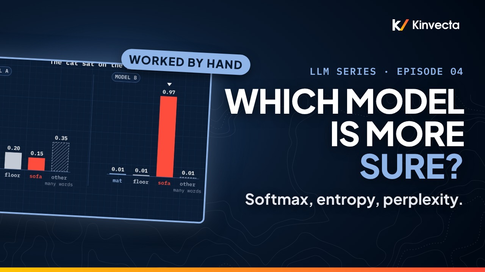

# Episode 4 · Probability, Entropy and Perplexity

[](https://youtu.be/WAzPH6pRwUc) [](https://colab.research.google.com/github/Kinvecta/how-llms-work/blob/main/Episode%2004%20-%20Probability%20Entropy%20and%20Perplexity/notebook.ipynb) [](slides.pdf) [](research-brief.md) [](transcript/Episode%2004%20-%20Probability%20Entropy%20and%20Perplexity%20-%20transcript.txt) [](https://youtu.be/0p3KPutSE9c)

<a href="https://youtu.be/WAzPH6pRwUc"></a>

**Length:** 18:33 · **Part I:** Foundations · **Math:** softmax, −Σ p ln p, e to the average surprise · **Code:** NumPy and matplotlib, runs anywhere

Two models finish "The cat sat on the…". One says mat 30%, floor 20%, sofa 15%. The other says sofa 97%. Both have a tallest bar, but one is far more sure of itself. In 1948 Claude Shannon defined the number that measures how sure, and language models are still graded with it. Episode 4 works every step by hand: the chain rule with GPT-2's real probabilities, softmax four times with every exponential written out, entropy term by term for three models, and perplexity for one token, two tokens and a whole sentence. Then the myth: a model can be 97% sure and still score a perplexity of 100.

## What you'll learn

- What a probability distribution is, and how the chain rule turns a sentence into a product of next-token probabilities
- Why those products shrink so fast (≈ 1.5 × 10⁻¹⁷ for our sentence on GPT-2 small), and why we switch to logs
- Softmax by hand: exponentiate, add, divide; why adding the same number to every score changes nothing; and the stable form real code uses
- Surprisal, −ln p, in nats and bits
- Entropy as average surprise, worked for four equal outcomes, Episode 1's model and a confident model
- Cross-entropy, KL divergence, and why a model can tie the target's entropy but never beat it
- Perplexity: 1/p for one token, ≈ 3.2 for two GPT-2 tokens, ≈ 48 for the whole sentence
- Why "perplexity is the number of choices" is exact only for a uniform distribution, and why confident is not correct

## Key ideas

- A distribution gives every outcome a number from 0 to 1, and the numbers add to 1. A language model's distribution is conditional: the next token, given the prefix.
- The chain rule: P(x₁, …, xₙ) = Π p(xₜ | x<ₜ). Every factor is below 1, so long texts get tiny probabilities; logs turn the product into a sum.
- Softmax(h)ᵢ = exp(hᵢ) / Σⱼ exp(hⱼ). Outputs are positive, sum to 1, and keep the order of the scores. Only differences between scores matter, so real code subtracts the largest score first.
- Surprisal is −ln p (nats) or −log₂ p (bits). Rare outcomes surprise more; a certain outcome surprises not at all.
- Entropy H(p) = −Σ pᵢ ln pᵢ is the average surprisal. It is 0 when one outcome is certain and largest (ln c) when c outcomes are equally likely.
- Cross-entropy H(q, p) = H(q) + D_KL(q ‖ p) ≥ H(q). Perplexity is e to the average surprisal of the tokens the model actually saw: one over the geometric mean of their probabilities.
- Perplexity says how surprised a model is by the text. It does not say whether the model is right, and it compares only across identical vocabularies.

## Worked by hand

**Softmax of h = (0, 1, 2).**

| Step | Work | Result |
|---|---|---|
| Exponentiate | e⁰ = 1 · e¹ = 2.718 · e² = 7.389 | |
| Add | 1 + 2.718 = 3.718; 3.718 + 7.389 | **11.107** |
| Divide | 1 ÷ 11.107 · 2.718 ÷ 11.107 · 7.389 ÷ 11.107 | **0.090 · 0.245 · 0.665** |
| Shift by +5 | e⁵ = 148.4 · e⁶ = 403.4 · e⁷ = 1096.6; sum 1648.5 | same three numbers |
| Stable form, −2 | e⁻² = 0.135 · e⁻¹ = 0.368 · e⁰ = 1; sum 1.503 | same three numbers |

**Entropy, term by term** (probability × surprisal; Episode 1's probabilities are illustrative).

| Model | Terms | H (nats) | H (bits) |
|---|---|---|---|
| Four equal outcomes | 4 × (0.25 × 1.386 = 0.347) | **1.386** | 2 |
| Model A: mat 0.30, floor 0.20, sofa 0.15, other 0.35 | 0.361 + 0.322 + 0.285 + 0.367 | **1.335** | 1.93 |
| Model B: sofa 0.97, the rest 0.01 | 0.030 + 3 × 0.046 | **≈ 0.17** | 0.24 |

**Perplexity.**

| Text | Average surprisal | Perplexity |
|---|---|---|
| One token, "mat" under Model A | −ln 0.30 = 1.204 nats | e^1.204 = **3.33** = 1 ÷ 0.30 |
| Two tokens, GPT-2 small: "on" 0.22, "the" 0.45 | (1.51 + 0.80) ÷ 2 = 1.16 nats | ≈ **3.2** = 1 ÷ √0.099 |
| Whole sentence, GPT-2 small, 10 tokens | 3.88 nats | ≈ **48** |
| "mat" under Model B (0.01) | 4.605 nats | **100** |

The GPT-2 small probabilities were measured in the [Episode 1 notebook](../Episode%2001%20-%20What%20an%20LLM%20Really%20Is/notebook.ipynb).

## Key terms

| Term | Meaning |
|---|---|
| Probability distribution | A number from 0 to 1 for every outcome; together they sum to 1 |
| Conditional probability, p(xₜ \| x<ₜ) | The next token's distribution, given the prefix |
| Chain rule of probability | P(x₁, …, xₙ) = Π p(xₜ \| x<ₜ) |
| Score vector, h | The last layer's output, one number per vocabulary token (Episode 3's h = Wu + β) |
| Softmax | exp(hᵢ) / Σⱼ exp(hⱼ): turns any scores into a distribution |
| Stable softmax | Subtract the largest score first; same answer, no overflow |
| Surprisal | −ln p (nats) or −log₂ p (bits) |
| Entropy, H(p) | −Σ pᵢ ln pᵢ: the average surprisal of one distribution |
| Cross-entropy, H(q, p) | −Σ qᵢ ln pᵢ: surprise measured with the model's probabilities, averaged over what really happens |
| KL divergence, D_KL(q ‖ p) | H(q, p) − H(q); never negative, zero only when p = q |
| Perplexity | e to the average per-token cross-entropy of the observed text; 2^H in bits |

## Run the notebook

The [companion notebook](notebook.ipynb) works every calculation the way the video does, prints each line of the worksheet, plots the distributions, and checks every value with an `assert`. No model download; it runs in seconds.

| Part | What it shows | Matches the video |
|:--:|---|---|
| 1 | The distribution adds to 1; the chain rule with GPT-2's factors; the shrinking product (plot) | 1.00 · 0.099 · ≈ 1.5 × 10⁻¹⁷ |
| 2 | `softmax_by_hand` for (0, 1, 2), +5 and −2; naive vs stable softmax on (1000, 1001, 1002); ln p back to p | 0.090, 0.245, 0.665 |
| 3 | Surprisal in nats and bits; `entropy_by_hand` for three models; entropy vs spread (plot); the lumped bucket | 1.386 · 1.335 · 0.17 |
| 4 | One-token perplexity; cross-entropy ≥ entropy; two GPT-2 tokens and the whole sentence (plot) | 3.33 · ≈ 3.2 · ≈ 48 |
| 5 | Confident is not correct; the check question | 0.17 nats, perplexity 100 |
| 6 | Try it: your own scores and distribution, with self-checks | your numbers |

Or run it locally:

```bash
git clone https://github.com/Kinvecta/how-llms-work.git
cd how-llms-work
python3 -m venv .venv && source .venv/bin/activate
pip install -r requirements.txt
python tools/check_notebooks.py "Episode 04 - Probability Entropy and Perplexity/notebook.ipynb"
# PASS  Episode 04 - Probability Entropy and Perplexity/notebook.ipynb
```

## Try it

About 15 minutes.

1. Pick three scores of your own and softmax them by hand. Then add 10 to each and do it again. Put your answer in the notebook's `my_answer` to check it.
2. In the notebook, even out the four probabilities in `my_dist` and watch the entropy climb toward ln 4 = 1.39 nats.
3. Compute the sentence's perplexity of 48 yourself from its ten per-token probabilities (they're in the notebook's setup cell).

## Check your understanding

1. Why does the probability of a whole sentence get so small, and what do we do about it?
2. Softmax (0, 1, 2) and softmax (5, 6, 7): same or different? Why?
3. What is the surprisal of an outcome with probability 1?
4. A model spreads its probability evenly over four words. What are its entropy (nats and bits) and its perplexity?
5. A second model gives "mat" 0.97 and 0.01 to each of the other three. Is its entropy higher or lower than the first model's?
6. That second model sees the word "floor" next. What is its perplexity on that token?

<details><summary>Answers</summary>

1. It is a product of many probabilities, each below 1, so it shrinks with every token (≈ 1.5 × 10⁻¹⁷ for our ten tokens on GPT-2 small). Taking logs turns the product into a sum.
2. The same: 0.090, 0.245, 0.665. Adding 5 multiplies every numerator and the denominator by e⁵, which cancels. Only differences between scores matter.
3. Zero: −ln 1 = 0. A certain outcome carries no surprise.
4. ln 4 = 1.39 nats = exactly 2 bits; perplexity 4.
5. Lower: about 0.17 nats against 1.39. Entropy depends only on the shape of the distribution, not on which word is on top.
6. 1 ÷ 0.01 = 100. Very sure, and very wrong: low entropy is not accuracy.

</details>

## Further reading

- The [research brief](research-brief.md) for this episode, with every source
- Shannon, "A Mathematical Theory of Communication," *Bell System Technical Journal* 27 (1948), and "Prediction and Entropy of Printed English" (1951)
- Goodfellow, Bengio and Courville, *Deep Learning* (MIT Press, 2016), §3.6 and §3.13 (chain rule, information theory) and §6.2.2.3 (softmax and its stable form)
- Jurafsky and Martin, *Speech and Language Processing*, 3rd ed. draft, chapter 3 (perplexity)

---

**Next:** [Episode 5, Calculus for Learning, Part 1: Derivatives and the Chain Rule](../Episode%2005%20-%20Derivatives%20and%20the%20Chain%20Rule/): mat's surprisal was 1.204 nats; we nudge the score for mat and watch that surprisal fall ([watch](https://youtu.be/ovpwjW2X9RE)).

[← Back to the course](../README.md)
