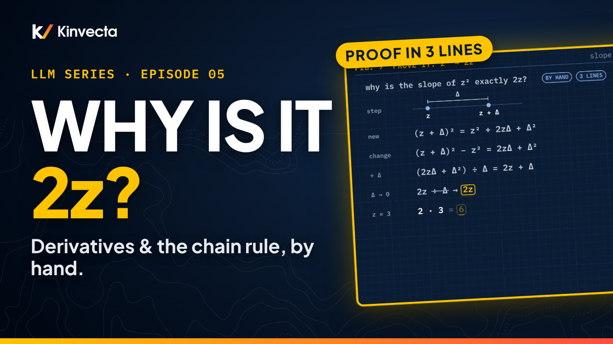

# Episode 5 · Derivatives and the Chain Rule

[](https://youtu.be/ovpwjW2X9RE) [](https://colab.research.google.com/github/Kinvecta/how-llms-work/blob/main/Episode%2005%20-%20Derivatives%20and%20the%20Chain%20Rule/notebook.ipynb) [](slides.pdf) [](research-brief.md) [](transcript/Episode%2005%20-%20Derivatives%20and%20the%20Chain%20Rule%20-%20transcript.txt) [](https://youtu.be/VlrSOMDDYk0)

<a href="https://youtu.be/ovpwjW2X9RE"></a>

**Length:** 13:09 · **Part I:** Foundations · **Math:** f′(z), the power rule, the quotient rule and the calculus chain rule · **Code:** NumPy and matplotlib, runs anywhere

A hiker stands on a mountainside in thick fog. No map, no view of the valley, only the tilt of the ground under her boots. That one feeling, the tilt, is how a language model learns, and it has a name: the derivative. Episode 4 left mat's surprisal at 1.204 nats; this episode, part 1 of Calculus for Learning, finds which way to nudge the model to make it smaller, and by how much. Every step is worked by hand: a slope the slow way, the power rule proved instead of memorized, the quotient rule written out, and the calculus chain rule pushed all the way through a real softmax to a slope of −0.70.

## What you'll learn

- What a derivative is: a rate of change at one point, like a speedometer, and the small-change rule f(z + Δ) ≈ f(z) + Δ · f′(z)
- How to find a slope the slow way (7, 6.1, 6.01 for z² at 3) and why the power rule gives exactly 6
- How to prove the power rule in three lines, and why the "extra bit" in each secant slope is the step itself
- Why the slope of surprisal, −ln p, is −1/p, and how well it predicts a small nudge (1.137 against the true 1.139)
- The calculus chain rule, d/dz f(g(z)) = f′(g(z)) · g′(z), and why it is not Episode 4's chain rule of probability
- The quotient rule, and how it turns the slope of a softmax probability into p(1 − p)
- How the chain rule runs through softmax: score → probability → surprisal, with slope −(1 − p) = −0.70
- Why a slope is a local guide, not a promise for big steps

## Key ideas

- The derivative f′(z) is the slope of f at z: how fast the output changes, per unit of input, right at one point. For a small nudge Δ, f(z + Δ) ≈ f(z) + Δ · f′(z).
- The secant slope of z² with step Δ is exactly 2z + Δ. Let the step shrink and 2z is what's left: the power rule, proved.
- Rules save the slow work: d/dz z² = 2z and d/dz ln z = 1/z. So surprisal S(p) = −ln p has slope −1/p.
- The calculus chain rule multiplies the effects along a chain: nudge z, g moves by g′ times the nudge, and f moves by f′ times that.
- Through softmax, with the other words' weight R held fixed, the quotient rule gives the probability of mat a slope of R · eᶻ ÷ (eᶻ + R)², which is p(1 − p). Mat's surprisal then has slope (−1/p) · p(1 − p) = −(1 − p).
- The slope is local: it predicts a small nudge almost exactly, and a big step badly, because the curve bends away from the straight line.

## Worked by hand

**A slope the slow way: f(z) = z² at z = 3** (f(3) = 9).

| Step | New value | Change | Slope | = 2z + step |
|---|---|---|---|---|
| 1 | f(4) = 16 | 16 − 9 = 7 | 7 ÷ 1 = **7** | 6 + 1 |
| 0.1 | 3.1² = 9.61 | 0.61 | 0.61 ÷ 0.1 = **6.1** | 6 + 0.1 |
| 0.01 | 3.01² = 9.0601 | 0.0601 | 0.0601 ÷ 0.01 = **6.01** | 6 + 0.01 |
| Power rule | d/dz z² = 2z | | 2 × 3 = **6** | step → 0 |

**The power rule, proved.** (z + Δ)² = z² + 2zΔ + Δ². Subtract z²: the change is 2zΔ + Δ². Divide by Δ: **2z + Δ**. As Δ → 0, the slope is 2z; at z = 3, 6.

Surprisal's slope at p = 0.30 is −1 ÷ 0.30 = −3.33. Nudge p to 0.32: the prediction 1.204 − 0.02 × 3.33 ≈ 1.137; the true −ln 0.32 = 1.139. Off by 0.002.

**The calculus chain rule.** Tiny example first: g(z) = 3z, f(u) = u², at z = 1, so g = 3, g′ = 3, f′(3) = 6, and 6 × 3 = **18**. The long way: f(g(z)) = 9z², derivative 18z, at 1: 18.

**Math Lab: through softmax.** z is the score for mat; R = 0.20 + 0.15 + 0.35 = 0.70 is held fixed; g(z) = eᶻ ÷ (eᶻ + R) and f(p) = −ln p. Start at z = ln 0.30, so g = 0.30 (Episode 1's probabilities are illustrative).

| Link | Work | Result |
|---|---|---|
| Outer: f′(p) = −1/p | −1 ÷ 0.30 | **−3.33** |
| Inner, quotient rule | (top′ · bottom − top · bottom′) ÷ bottom², top = eᶻ, bottom = eᶻ + R, both slopes eᶻ | [eᶻ(eᶻ + R) − eᶻ · eᶻ] ÷ (eᶻ + R)² |
| Cancel eᶻ · eᶻ | R · eᶻ ÷ (eᶻ + R)² | g′(z) |
| Numbers | eᶻ = 0.30, bottom = 0.30 + 0.70 = 1; 0.70 × 0.30 ÷ 1² | **0.21** |
| Rewrite | eᶻ ÷ bottom = p, R ÷ bottom = 1 − p, so p(1 − p) = 0.30 × 0.70 | **0.21** |
| Multiply | (−1 ÷ 0.30) × 0.21 = −(0.21 ÷ 0.30) | **−0.70** |
| Shortcut | (1/p) · p(1 − p) = 1 − p, so −(1 − p) | **−0.70** |
| Nudge z by +0.1 | predicted drop 0.1 × 0.70 = 0.070; p 0.300 → 0.321, S 1.204 → 1.135 | actual drop **0.069** |
| Step z by +1.0 | predicted drop 0.70; p → 0.538, S → 0.620 | actual drop **0.584** |

## Key terms

| Term | Meaning |
|---|---|
| Derivative, f′(z) | The slope of f at z: how fast the output changes, per unit of input, at one point |
| Small-change rule | f(z + Δ) ≈ f(z) + Δ · f′(z), good for a small Δ |
| Secant slope | (f(z + Δ) − f(z)) ÷ Δ: the slope measured with a finite step; it closes in on f′(z) as Δ shrinks |
| Power rule | d/dz zⁿ = n zⁿ⁻¹; for z², 2z |
| Quotient rule | (top ÷ bottom)′ = (top′ · bottom − top · bottom′) ÷ bottom² |
| Calculus chain rule | d/dz f(g(z)) = f′(g(z)) · g′(z): multiply the effects along a chain. Not the chain rule of probability |
| Surprisal slope | d/dp (−ln p) = −1/p |
| Softmax slope, p(1 − p) | The slope of a softmax probability with respect to its own score |

## Run the notebook

The [companion notebook](notebook.ipynb) works every calculation the way the video does, prints each line of the worksheet, plots the curves, and checks every value with an `assert`. It runs in seconds.

| Part | What it shows | Matches the video |
|:--:|---|---|
| 1 | The speedometer idea; `slope_by_hand` for z² at 3; the power-rule proof checked for several steps; the rules; secants closing in on the tangent (plot) | 7, 6.1, 6.01 → 6 · 2z + Δ |
| 2 | Surprisal's slope and the 0.30 → 0.32 check; −ln p with its tangent (plot) | −3.33 · 1.137 vs 1.139 |
| 3 | `chain_by_hand` for the tiny example; softmax with R held fixed; the quotient rule worked out and checked against finite differences and p(1 − p); multiply the links | 18 · −3.33 · 0.21 · −0.70 |
| 4 | `nudge_by_hand` for +0.1 and +1.0; surprisal against the score with the +1.0 gap (plot) | 0.069 · 0.584 |
| 5 | The check question, by hand and measured on the real chain | −2 · 0.25 · −0.50 |
| 6 | Try it: z³ at 2 with a hint for proving 3z², your own nudge, the quotient rule at p = 0.50 | 19, 12.61, 12.0601 → 12 · your numbers |

Or run it locally:

```bash
git clone https://github.com/Kinvecta/how-llms-work.git
cd how-llms-work
python3 -m venv .venv && source .venv/bin/activate
pip install -r requirements.txt
python tools/check_notebooks.py "Episode 05 - Derivatives and the Chain Rule/notebook.ipynb"
# PASS  Episode 05 - Derivatives and the Chain Rule/notebook.ipynb
```

## Try it

About 15 minutes.

1. Find the slope of z³ at 2 the slow way, with steps of 1, 0.1 and 0.01. Then prove the rule the way the video did for z². Put your answer in the notebook's `my_answer` to check it.
2. In the notebook, nudge mat's score by 0.1 and confirm the drop of about 0.07. Then try a bigger nudge and watch the straight-line prediction drift.
3. Redo the quotient rule with p = 0.50, all on paper, and check your inner link in the notebook's `my_inner`.

## Check your understanding

1. The secant slopes of z² at 3 are 7, 6.1 and 6.01 for steps of 1, 0.1 and 0.01. What is the derivative, and which rule gives it directly?
2. Prove that the secant slope of z² with step Δ is 2z + Δ. What does that say about the 7, 6.1 and 6.01?
3. What is the slope of surprisal, −ln p, at p = 0.30, what does its sign tell you, and how good is the prediction for p = 0.32?
4. With g(z) = eᶻ ÷ (eᶻ + R), R = 0.70 and z = ln 0.30, use the quotient rule to find g′(z). Then check it with p(1 − p).
5. Mat's surprisal has slope −0.70 with respect to mat's score. Roughly how much does surprisal fall if you raise the score by 0.1? Why does the prediction fail for a step of 1.0?
6. Suppose mat's probability were 0.50 instead of 0.30. What are the outer link, the inner link, and the slope of surprisal with respect to mat's score?

<details><summary>Answers</summary>

1. 6. The power rule: d/dz z² = 2z, and 2 × 3 = 6. The secant slopes close in on it as the step shrinks.
2. (z + Δ)² = z² + 2zΔ + Δ²; subtract z² to get 2zΔ + Δ²; divide by Δ to get 2z + Δ. At z = 3: 7 = 6 + 1, 6.1 = 6 + 0.1, 6.01 = 6 + 0.01. The extra bit was always the size of the step, and it vanishes as the step shrinks.
3. −1 ÷ 0.30 = −3.33. Negative: raise mat's probability and its surprisal falls, about 3.33 times as fast. The prediction 1.204 − 0.02 × 3.33 ≈ 1.137 misses the true −ln 0.32 = 1.139 by only 0.002.
4. [eᶻ(eᶻ + R) − eᶻ · eᶻ] ÷ (eᶻ + R)² = R · eᶻ ÷ (eᶻ + R)². With eᶻ = 0.30 and a bottom of 0.30 + 0.70 = 1: 0.70 × 0.30 ÷ 1² = 0.21. And p(1 − p) = 0.30 × 0.70 = 0.21. Same answer, two ways.
5. About 0.1 × 0.70 = 0.070 (the actual drop is 0.069). For a step of 1.0 the prediction says 0.70 but the actual drop is 0.584: the slope is local, and the curve bends away from the straight line.
6. Outer: −1 ÷ 0.50 = −2. Inner: 0.50 × 0.50 = 0.25. Multiply: −2 × 0.25 = −0.50, and the shortcut −(1 − p) agrees.

</details>

## Further reading

- The [research brief](research-brief.md) for this episode, with every source
- Goodfellow, Bengio and Courville, *Deep Learning* (MIT Press, 2016), chapter 4, §4.3 (the derivative and the small-change rule)
- 3Blue1Brown, *Essence of calculus*, chapter 5: "Visualizing the chain rule and product rule"
- OpenStax, *Calculus Volume 1*, chapter 3 (derivatives)

---

**Next:** [Episode 6, The Gradient and the Step](../Episode%2006%20-%20The%20Gradient%20and%20the%20Step/): a real model has millions of numbers, not one. We put all their slopes into one arrow, take a step downhill, and watch a step that's too big send us uphill, from 3 all the way to 19. ([watch](https://youtu.be/sxR34_sC0no), notebook in [`Episode 06 - The Gradient and the Step/`](../Episode%2006%20-%20The%20Gradient%20and%20the%20Step/)).

[← Back to the course](../README.md)
