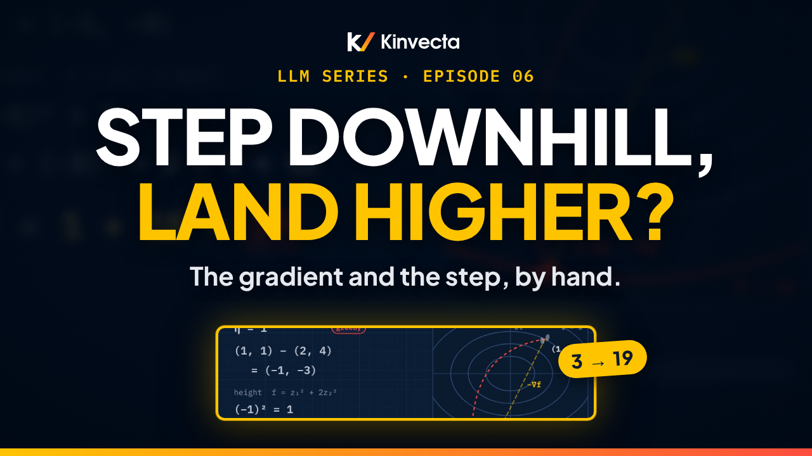

# Episode 6 · The Gradient and the Step

[](https://youtu.be/sxR34_sC0no) [](https://colab.research.google.com/github/Kinvecta/how-llms-work/blob/main/Episode%2006%20-%20The%20Gradient%20and%20the%20Step/notebook.ipynb) [](slides.pdf) [](research-brief.md) [](transcript/Episode%2006%20-%20The%20Gradient%20and%20the%20Step%20-%20transcript.txt) [](https://youtu.be/QMFLrOGVr0o)

<a href="https://youtu.be/sxR34_sC0no"></a>

**Length:** 11:31 · **Part I:** Foundations · **Math:** ∂f/∂z₁, ∇f, ∇f · a = ‖∇f‖ cos φ and z − η∇f · **Code:** NumPy and matplotlib, runs anywhere

You stand in a valley shaped like a bowl, at height 3. You take one step, straight downhill, and land at height 19. Same direction, just a bigger step. Episode 5 found one slope, −0.70 for mat's score; a real model has millions of numbers. This episode, part 2 of Calculus for Learning, puts all their slopes into one arrow, the gradient, steps against it, and finds exactly when that step backfires. Every step is worked by hand: the four-word softmax gradient, a gradient and three directions on a bowl, two steps, one down to 1.36 and one up to 19, and the curve 3 − 20η + 36η² derived line by line. Then the myth: the steepest way down misses the bottom by 18.4°.

## What you'll learn

- What a partial derivative is, and how the gradient collects all of them into one vector
- Your first real gradient, from softmax: −0.70, +0.20, +0.15, +0.35, adding to zero
- How to compute a gradient by hand: ∇f = (2, 4) at (1, 1) on the bowl z₁² + 2z₂², with length √20 ≈ 4.47
- How to test directions by hand (2, 4 and 4.47), and why the gradient points steepest uphill
- The gradient step z − η∇f: why a small step goes down to 1.36 and a big one goes up to 19
- How to derive the height along the step, f(η) = 3 − 20η + 36η², and read its limits: 0.556, 0.278, 0.222
- Why "the gradient points to the bottom" is a myth

## Key ideas

- The partial derivative ∂f/∂z₁ measures how f changes when only z₁ moves, with everything else frozen. The gradient ∇f is the vector of all the partials.
- For mat's surprisal under softmax, the partial with respect to each score is that word's probability minus its target: mat −0.70, floor +0.20, sofa +0.15, other +0.35. They add to zero.
- The slope in a unit direction a is ∇f · a = ‖∇f‖ cos φ, largest at φ = 0. So ∇f points steepest uphill and −∇f steepest downhill (for a smooth f, a nonzero gradient and ordinary Euclidean distance).
- A gradient step z → z − η∇f lowers f only for a small enough η, small compared with the curvature. Too big, and the step moves uphill.
- Along the step from (1, 1), the height is 3 − 20η + 36η²: the 20 is ∇f · ∇f, the downhill pull; the 36η² is the curvature term, and it grows fast.
- The gradient is local: it tells you which way is down from here, not where the bottom is.

## Worked by hand

**The four-word softmax gradient** (slope of mat's surprisal with respect to each score; Episode 1's probabilities are illustrative).

| Word | Probability | Target | Slope |
|---|---|---|---|
| mat | 0.30 | 1 | 0.30 − 1 = **−0.70** |
| floor | 0.20 | 0 | **+0.20** |
| sofa | 0.15 | 0 | **+0.15** |
| other | 0.35 | 0 | **+0.35** |
| Sum | | | **0** |

**The bowl f(z₁, z₂) = z₁² + 2z₂² at (1, 1).**

| Step | Work | Result |
|---|---|---|
| Height | 1² + 2 × 1² = 1 + 2 | **3** |
| Gradient | ∂f/∂z₁ = 2z₁ = 2 · ∂f/∂z₂ = 4z₂ = 4 | **∇f = (2, 4)** |
| Steepness | √(2² + 4²) = √(4 + 16) = √20 | **≈ 4.47** |
| Direction (1, 0) | 2 × 1 + 4 × 0 | **2** |
| Direction (0, 1) | 2 × 0 + 4 × 1 | **4** |
| Direction (2, 4)/√20 | (2 × 2 + 4 × 4) ÷ 4.47 = 20 ÷ 4.47 | **4.47**, steeper than both |

**Two steps, and the curve behind them.**

| Step | Work | Result |
|---|---|---|
| η = 0.1 | (1, 1) − (0.2, 0.4) = (0.8, 0.6); 0.64 + 2 × 0.36 = 0.64 + 0.72 | **1.36** (down) |
| η = 1 | (1, 1) − (2, 4) = (−1, −3); 1 + 2 × 9 = 1 + 18 | **19** (up) |
| The point after η | (1 − 2η, 1 − 4η) | |
| First term | (1 − 2η)² = 1 − 4η + 4η² | |
| Second term, doubled | 2(1 − 4η)² = 2 − 16η + 32η² | |
| Add | | **f(η) = 3 − 20η + 36η²** |
| Check | η = 0.1: 3 − 2 + 0.36 · η = 1: 3 − 20 + 36 | **1.36** · **19** |
| Back to 3 | 36η² = 20η, so η = 20/36 | **0.556** |
| Best step | halfway: 20/72; 3 − 5.56 + 2.78 | η ≈ **0.278** → f ≈ **0.222** |
| The myth | −∇f = (−2, −4) vs (−1, −1): 6 ÷ (√20 × √2) = 6 ÷ 6.325 = 0.949 | angle ≈ **18.4°** |

## Key terms

| Term | Meaning |
|---|---|
| Partial derivative, ∂f/∂z₁ | How f changes when only z₁ moves, with everything else frozen |
| Gradient, ∇f | The vector of all partial derivatives; points steepest uphill |
| Directional derivative, D_a f | The slope in a unit direction a: ∇f · a = ‖∇f‖ cos φ |
| Contour line | A curve where f has one value; on this bowl, ellipses around (0, 0) |
| Gradient step | z → z − η∇f |
| Step size, η | How far each step moves against the gradient; Episode 8 calls it the learning rate |
| Curvature | How fast the slope itself changes; in f(η) = 3 − 20η + 36η² it is the 36η² term that makes big steps go uphill |
| Gradient descent | Taking gradient steps over and over |

## Run the notebook

The [companion notebook](notebook.ipynb) works every calculation the way the video does, prints each line of the worksheet, plots the bowl and the curves, and checks every value with an `assert`. It runs in seconds.

| Part | What it shows | Matches the video |
|:--:|---|---|
| 1 | The four-word softmax gradient, checked by nudging each score; the bowl's height, gradient and length | −0.70, +0.20, +0.15, +0.35 · 3 · (2, 4) · √20 ≈ 4.47 |
| 2 | Three directions by hand, each measured; the steepest of 3,600 unit directions | 2 · 4 · 4.47 |
| 3 | `gradient_step_by_hand` for η = 0.1 and η = 1; the curve 3 − 20η + 36η² expanded line by line and checked against the bowl; the limits; f(η) with the decrease zone (plot) | 1.36 · 19 · 0.556 · 0.278 → 0.222 |
| 4 | The myth's angle; the bowl's contours with ∇f, −∇f, the way to the bottom and both landing points (plot); the check question | 18.4° · (4, 4) · 5.66 |
| 5 | Try it: η = 0.5 and 0.6, a gradient-descent loop with your own η (plot), and the slope along (1, 1)/√2 | 2 · 3.96 · 4.24 · your numbers |

Or run it locally:

```bash
git clone https://github.com/Kinvecta/how-llms-work.git
cd how-llms-work
python3 -m venv .venv && source .venv/bin/activate
pip install -r requirements.txt
python tools/check_notebooks.py "Episode 06 - The Gradient and the Step/notebook.ipynb"
# PASS  Episode 06 - The Gradient and the Step/notebook.ipynb
```

## Try it

About 15 minutes.

1. From (1, 1), try η = 0.5 and η = 0.6 with the formula 3 − 20η + 36η², and see which side of 3 each lands on.
2. In the notebook, run gradient descent with your own step size and watch it settle, or blow up.
3. Find the slope in the direction (1, 1)/√2 by hand. Put your answer in the notebook's `my_slope` to check it.

## Check your understanding

1. Mat's surprisal under softmax has slopes −0.70, +0.20, +0.15 and +0.35 with respect to the four scores. What do they add to, and why can't you push one probability up on its own?
2. On the bowl f = z₁² + 2z₂², what are the height, the gradient and the gradient's length at (1, 1)?
3. At (1, 1), what is the slope in the directions (1, 0), (0, 1) and (2, 4)/√20? Why is the last one the steepest?
4. From (1, 1), a step with η = 1 lands at (−1, −3). Is f higher or lower than where it started, and why?
5. Same bowl, at (2, 1). What is the gradient, which unit direction lowers f fastest, and roughly how much does f fall per unit of distance that way?
6. True or false: the negative gradient points to the bottom of the bowl.

<details><summary>Answers</summary>

1. Zero. Under softmax the probabilities always add to 1, so if mat goes up the others must go down. The knob is the score, and raising mat's score lowers its surprisal while raising any other score raises it.
2. Height 1 + 2 = 3. Gradient (2 × 1, 4 × 1) = (2, 4). Length √(4 + 16) = √20 ≈ 4.47.
3. 2, 4 and 20 ÷ 4.47 = 4.47. The slope in a unit direction is ∇f · a = ‖∇f‖ cos φ, largest when the angle φ to the gradient is zero.
4. Higher: 1 + 2 × 9 = 19, up from 3. Along that line f(η) = 3 − 20η + 36η², which falls only for 0 < η < 0.556. At η = 1 the curvature term wins.
5. ∇f = (4, 4). Fastest decrease: (−1, −1)/√2. It falls at about ‖∇f‖ = √32 = 4√2 ≈ 5.66 per unit distance.
6. False. At (1, 1), −∇f = (−2, −4) and the direction to the bottom is (−1, −1); the angle between them is about 18.4°. Steepest-down is square to the contour line, and these contours are stretched ellipses.

</details>

## Further reading

- The [research brief](research-brief.md) for this episode, with every source
- Goodfellow, Bengio and Courville, *Deep Learning* (MIT Press, 2016), chapter 4, §4.3 (gradient-based optimization) and §4.3.1 (curvature, and why a gradient step can move uphill)
- Guichard, *Calculus: Early Transcendentals*, §14.5 (directional derivatives and the gradient)

---

**Next:** Episode 7, What Learning Means: Data, Models, Loss: mat's surprisal is one term; training averages thousands of them into a single number, the loss. Its notebook is already in [`notebooks/`](../notebooks/).

[← Back to the course](../README.md)
