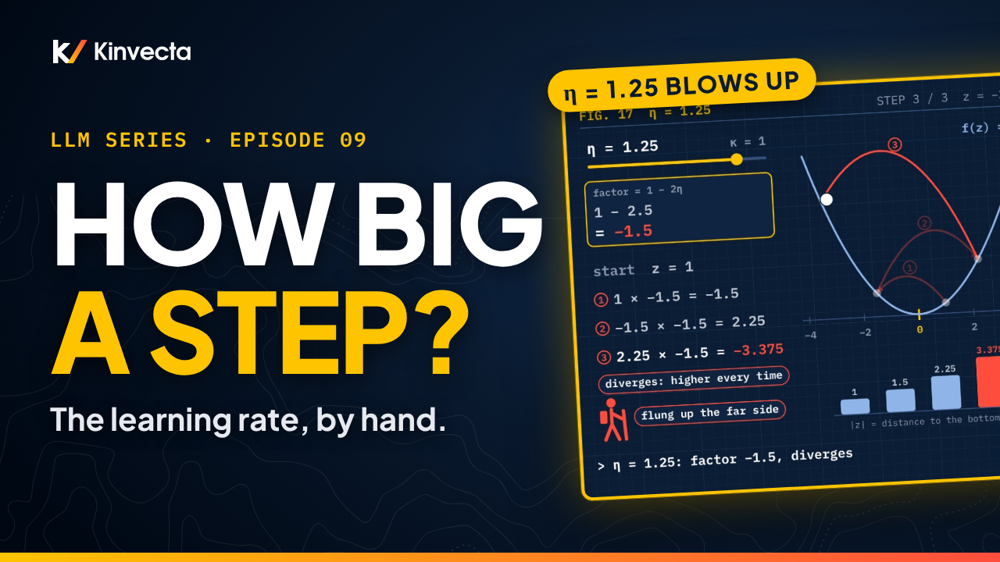

# Episode 9 · Gradient Descent, Part 1: The Learning Rate, by Hand

[](https://youtu.be/9H0EDfR4wFo) [](https://colab.research.google.com/github/Kinvecta/how-llms-work/blob/main/Episode%2009%20-%20Gradient%20Descent%2C%20Part%201/notebook.ipynb) [](slides.pdf) [](research-brief.md) [](transcript/Episode%2009%20-%20Gradient%20Descent%2C%20Part%201%20-%20transcript.txt) [](https://youtu.be/xgkeDlXSpdU)

<a href="https://youtu.be/9H0EDfR4wFo"></a>

**Length:** 16:44 · **Part II:** How Machines Learn · **Math:** θ ← θ − η ∇_θ L(θ), z ← (1 − 2ηκ) z, settles exactly when 0 < η < 1/κ · **Code:** NumPy and matplotlib, runs anywhere

Three hikers stand at the top of the same foggy hill. All three feel the same slope and walk the same way. The first takes tiny steps and is still near the top at sunset. The second takes giant leaps and is flung up the far side. The third takes steps that are just right, and is at the bottom in five. The only difference is the size of the stride, and when a language model learns, that stride has a name: the learning rate. Episode 6 took one step down a bowl (from height 3 to 1.36 with a step of 0.1, up to 19 with a step of 1). Training takes thousands. This episode, part 1 of Gradient Descent, repeats the step by hand: the update rule read piece by piece, a valley with one knob where every step multiplies your distance from the bottom by the same factor, 1 − 2ηκ, six learning rates that slide in, land in one step, hop, bounce and blow up, and the bowl from Episode 6, where the steepest direction sets the speed limit and the best repeated step is 1/3, not Episode 6's 0.278.

## What you'll learn

- How to read the update rule θ ← θ − η ∇_θ L(θ), piece by piece, and why the steps shrink by themselves near the bottom
- Why every step in the valley f(z) = κz² multiplies your distance from the bottom by the same factor, 1 − 2ηκ
- What each learning rate does: slide in, land in one step, hop and shrink, bounce forever, or blow up, and why it settles exactly when 0 < η < 1/κ
- How slow "safe" is: 228 steps at η = 0.01, 7 at 0.25, 1 at 0.5
- Why, in a bowl with two directions, the steepest direction sets the speed limit for everyone
- Why the best single step is not the best step to repeat, and why a stretched bowl is slow for every η
- Why mat's surprisal from Episode 5 has no bottom to overshoot, and why "a smaller learning rate is always safer" is a myth

## Key ideas

- Gradient descent repeats one rule: θ ← θ − η ∇_θ L(θ). θ is all the knobs, the gradient is the list of slopes, the minus sign turns us downhill, and η is the learning rate, "a positive scalar determining the size of the step" (Goodfellow, Bengio and Courville). Repeat until the gradient is zero or very close.
- The step is η × slope, so even with a fixed η the steps shrink as the ground flattens near the bottom.
- In the valley f(z) = κz², the slope is 2κz (Episode 5), and one step gives z − η · 2κz = (1 − 2ηκ) z. After k steps, z = (1 − 2ηκ)^k · z₀. A factor of 0.8 keeps 80% of the distance every step.
- The zones: 0 < η < 1/(2κ) slides in from one side; η = 1/(2κ) lands in one step; between 1/(2κ) and 1/κ it hops and shrinks; η = 1/κ bounces forever; above 1/κ it blows up. Gradient descent settles exactly when 0 < η < 1/κ.
- Small is safe but slow: for small η the step count is roughly 2.3 / η. Ten times smaller η, about ten times longer.
- In the bowl f = z₁² + 2z₂², each knob gets its own factor, 1 − 2η and 1 − 4η. Both must stay smaller than 1 in size, so the limit is 0.5, set by the steeper direction.
- One step is not the walk. Episode 6's one step goes down for any η below 0.556, but repeated, η = 0.52 goes 3, 2.334, 2.721. The best repeated step makes both factors the same size: η = 1/3.
- A stretched bowl is slow for every η. Stretched 50 to 1, the best factor is 0.961 and it takes 116 steps; Episode 7's loss for the three dots is stretched about 46 to 1 (best factor 0.958, about 107 steps). Goodfellow et al.: ill-conditioning can leave SGD "stuck".
- Not every loss is a bowl. On mat's surprisal, bigger η was faster in every run checked: the loss keeps falling toward zero and never reaches it, so there is no bottom to fly past.

## Worked by hand

**The update rule, piece by piece.**

| Piece | Meaning |
|---|---|
| θ | All the knobs |
| ∇_θ L(θ) | The gradient: the list of slopes, one per knob; points uphill the fastest |
| − | The minus sign: turns us around, so we walk downhill |
| η | The learning rate: how far to go |

**One step in the valley f(z) = κz².** The slope is 2κz, so the new z is z − η · 2κz = **(1 − 2ηκ) · z**. The bracket is the factor.

**Six learning rates** (κ = 1, start at z = 1).

| η | Factor 1 − 2η | z after steps 1, 2, 3 | What happens |
|:--:|:--:|---|---|
| 0.1 | 0.8 | 0.8, 0.64, 0.512 | slides in slowly (the first hiker) |
| 0.25 | 0.5 | 0.5, 0.25, 0.125 | halves every step |
| 0.5 | 0 | 0, 0, 0 | lands in one step (the third hiker): the slope at z = 1 is 2, and 0.5 × 2 = 1, the distance |
| 0.75 | −0.5 | −0.5, 0.25, −0.125 | hops sides, shrinks |
| 1 | −1 | −1, 1, −1 | bounces forever |
| 1.25 | −1.5 | −1.5, 2.25, −3.375 | diverges (the second hiker) |

**Steps to get within 0.01 of the bottom** (κ = 1, from z = 1).

| η | 0.01 | 0.25 | 0.5 |
|---|:--:|:--:|:--:|
| Steps | **228** | **7** | **1** |

For small η, the count is roughly 2.3 / η.

**The bowl f = z₁² + 2z₂²**, start (1, 1), height 3. The gradient is (2z₁, 4z₂); the factors are 1 − 2η for z₁ and 1 − 4η for z₂.

| η | Heights after 0, 1, 2, 3 steps | |
|:--:|---|---|
| 0.1 | 3, 1.36, 0.669, 0.355 | factors 0.8 and 0.6: 0.8² + 2 × 0.6² = 0.64 + 0.72 = 1.36, exactly Episode 6's step |
| 1/3 | 3, 0.333, 0.037, 0.004 | both factors 1/3: the height divides by 9 every step (3/9^k); 5 steps bring both knobs within 0.01 |
| 0.278 | 3, 0.222, 0.039, 0.008 | Episode 6's best single step: ahead after step 1, behind by step 2 |
| 0.5 | 3, 2, 2, 2 | the limit: z₂ flips between −1 and 1, stuck at 2 |
| 0.52 | 3, 2.334, 2.721 | down, then back up |
| 1 | 3, 19, 163, 1459 | blows up |

**The best repeated step.** Make both factors the same size: 1 − 2η = −(1 − 4η), so **η = 1/3**.

**Mat's surprisal** (Episode 5: slope −0.70, so each step raises mat's score by 0.70 × η). One step from p(mat) = 0.30:

| η | 0.1 | 1 | 5 |
|---|:--:|:--:|:--:|
| p(mat) | 0.315 | 0.463 | **0.934** |

## Key terms

| Term | Meaning |
|---|---|
| Gradient descent | Repeating θ ← θ − η ∇_θ L(θ) until the gradient is zero or very close |
| Learning rate, η (eta) | The step size: how far each step goes. Goodfellow et al. write it with another Greek letter; this series uses η, like Ruder |
| Steepness, κ (kappa) | How steep the valley f(z) = κz² is; κ > 0 |
| The factor, 1 − 2ηκ | What every step multiplies the distance from the bottom by |
| Converge (settle) | The steps close in on the bottom: |factor| < 1 |
| Diverge | The numbers run away and grow without end: |factor| > 1 |
| Stretched bowl (ill-conditioned) | A bowl much steeper in one direction than another; the steep direction sets the limit and the gentle one pays for it |

## Run the notebook

The [companion notebook](notebook.ipynb) works every calculation the way the video does, prints each line of the worksheet, plots the walks, the η number line, the step counts and the bowl, and checks every value with an `assert`. It runs in seconds.

| Part | What it shows | Matches the video |
|:--:|---|---|
| 1 | The update rule; one step on Episode 6's bowl; steps that shrink by themselves with a fixed η | 1.36 · 19 |
| 2 | The valley κz²: the slope 2κz, the factor 1 − 2ηκ checked on random cases, six learning rates (plots), the zones on a number line (plot), and steps to 0.01 against η (plot) | 0.8, 0.64, 0.512 · −1.5, 2.25, −3.375 · 228 / 7 / 1 · 2.3 / η |
| 3 | The bowl z₁² + 2z₂²: two factors, the limit 0.5, Episode 6's one-step numbers, the best repeated step, and the race (plots) | 1.36, 0.669, 0.355 · 2, 2, 2 · 19, 163, 1459 · 2.334, 2.721 · 3/9^k · 5 steps |
| 4 | A bowl stretched 50 to 1; Episode 7's three dots as a stretched bowl (the half-pipe, plot); mat's surprisal (plot) | 0.961, 116 · about 46 to 1, 0.958, about 107 · 0.315, 0.463, 0.934 |
| 5 | The myth: step counts, a fixed step budget on the bowl, and a nearly flat valley | 228 vs 7 · 1/3 |
| 6 | The check question | 1/3 · 0.4, 0.48 · 1/6 |
| 7 | Try it: your own κ's one-step η, sliding η across 1/κ, and the race between 0.278 and 1/3, each with a self-check | your numbers |

Or run it locally:

```bash
git clone https://github.com/Kinvecta/how-llms-work.git
cd how-llms-work
python3 -m venv .venv && source .venv/bin/activate
pip install -r requirements.txt
python tools/check_notebooks.py "Episode 09 - Gradient Descent, Part 1/notebook.ipynb"
# PASS  Episode 09 - Gradient Descent, Part 1/notebook.ipynb
```

## Try it

A pencil and a quarter of an hour.

1. Pick your own κ, find the η that lands in one step, and check it with a pencil (`my_kappa`, `my_eta_one_step`).
2. In the notebook, slide η across 1/κ and watch the steps flip from settling to blowing up (`slide_kappa`, `slide`).
3. On the bowl, run five steps at 0.278 and five steps at 1/3, and see which one wins (`my_race`, `my_winner`).

The one mistake to avoid: judging a learning rate by a single step. One step can go down while the next ten go up.

## Check your understanding

1. In θ ← θ − η ∇_θ L(θ), what does each piece do, and why does the minus sign matter?
2. Why do the steps shrink near the bottom even when η stays the same?
3. In the valley f(z) = κz², what does one step multiply z by, and what is z after k steps?
4. With κ = 1 and z = 1, what happens at η = 0.75? At η = 1? At η = 1.25?
5. On the bowl z₁² + 2z₂², why is the limit 0.5 and not 1?
6. Episode 6's best single step was about 0.278. Why is the best step to repeat 1/3 instead?
7. Take f(z) = 3z². For which η does gradient descent settle? Starting from z = 1 with η = 0.1, what are z and f after one step? Which η lands at the bottom in a single step?
8. True or false: a smaller learning rate is always safer.

<details><summary>Answers</summary>

1. θ is all the knobs; the gradient is the list of slopes and points uphill the fastest; the minus sign turns us around so we walk downhill; η, the learning rate, says how far to go. Without the minus sign, we would climb.
2. The step is η × slope. Near the bottom the ground flattens, so the slope shrinks, and the step shrinks with it.
3. The factor 1 − 2ηκ, since z − η · 2κz = (1 − 2ηκ) z. After k steps, z = (1 − 2ηκ)^k · z₀.
4. η = 0.75: the factor is −0.5, so z goes −0.5, 0.25, −0.125: it hops sides but shrinks, and still arrives. η = 1: the factor is −1, so z goes −1, 1, −1 forever. η = 1.25: the factor is −1.5, so z goes −1.5, 2.25, −3.375: it diverges.
5. Each knob has its own factor: 1 − 2η for z₁ needs η < 1, but 1 − 4η for z₂ needs η < 0.5. Both must settle, so the steeper direction sets the limit: 0.5.
6. 0.278 is the best for one step only. Repeated, the best step makes both factors the same size: 1 − 2η = −(1 − 4η) gives η = 1/3, and both factors become 1/3. The race: 0.278 is ahead after one step (0.222 against 0.333), behind by step 2, and about twice as high by step 3 (0.008 against 0.004).
7. κ = 3, so 0 < η < 1/3. The factor is 1 − 2 × 0.1 × 3 = 1 − 0.6 = 0.4, so z = 0.4 and f = 3 × 0.4² = 3 × 0.16 = 0.48, down from 3. The one-step landing is half of 1/3: η = 1/6.
8. False. Anything between 0 and 1/κ settles, and too large can blow up. But smaller is slower: 228 steps at 0.01 against 7 at 0.25. Where the ground is nearly flat, a tiny η crawls; on the bowl the best step was 1/3, not the smallest; and real training runs have a budget that can run out before you arrive.

</details>

## Further reading

- The [research brief](research-brief.md) for this episode, with every source
- Goodfellow, Bengio and Courville, *Deep Learning* (MIT Press, 2016), §4.3 (gradient-based optimization: the update rule, eq. 4.5, and the learning rate) and §8.2.1 (ill-conditioning)
- Ruder, "An overview of gradient descent optimization algorithms", arXiv:1609.04747 (2016), §2 (gradient descent variants) and §3 (challenges: choosing the learning rate)
- 3Blue1Brown, *Neural networks*, chapter 2, "Gradient descent, how neural networks learn"

---

**Previous:** [Episode 8, Maximum Likelihood, by Hand](https://youtu.be/u1bSbpKfF6g) · [episode page](../Episode%2008%20-%20Maximum%20Likelihood/)

**Next:** Episode 10, gradient descent, part 2. Why the very same η can be fine on an average and explode on a sum, and mini-batches: why real training never uses all its data for a single step, and why that turns out to be a feature, not a bug. Coming next; the notebook is ready: [Episode 10 - Gradient Descent](../notebooks/Episode%2010%20-%20Gradient%20Descent.ipynb).

[← Back to the course](../README.md)
