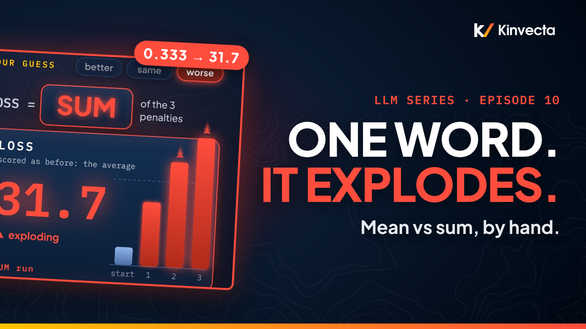

# Episode 10 · Gradient Descent, Part 2: Mean vs Sum, and Mini-batches

[](https://youtu.be/775cpR2pelw) [](https://colab.research.google.com/github/Kinvecta/how-llms-work/blob/main/Episode%2010%20-%20Gradient%20Descent%2C%20Part%202/notebook.ipynb) [](slides.pdf) [](research-brief.md) [](transcript/Episode%2010%20-%20Gradient%20Descent%2C%20Part%202%20-%20transcript.txt) [](https://youtu.be/ADgzE4Fm898)

<a href="https://youtu.be/775cpR2pelw"></a>

**Length:** 17:47 · **Part II:** How Machines Learn · **Math:** the slope of an average is the average of the slopes, η on the sum acts like N × η on the mean, variance ∝ 1/batch size · **Code:** NumPy and matplotlib, runs anywhere

Take Episode 7's three dots and line A, and take one step of gradient descent with a step size of 0.1. The loss falls from 1/3 to about 0.133: a calm step. Now change one word in how the loss is written. Instead of averaging the three penalties, add them up. Same dots, same line, same step size, and the loss goes to 1.2, then 5.95, then 31.7. One word turned a calm walk into an explosion. That is the first puzzle of this episode. The second: a real language model learns from billions of words, yet it never looks at all of them before taking a step. It grabs a small handful, steps, and grabs another, like a chef who tastes a chunky stew by the spoonful instead of eating the whole pot. This episode works both puzzles by hand: the gradient one dot at a time, the mean and the sum side by side, why adding makes the valley N times as steep, and then mini-batches, where a random handful is usually off on any one draw, right on average, and noisy in a way you can measure with a pencil.

> **How this episode teaches.** This one is built for a pencil. Before each result, the video asks a question, shows everything you need on screen, and pauses for a few seconds so you can predict the answer before it is revealed. Two longer checks, one at the end of each part, ask you to pause and work a full problem. The notebook marks the same moments with **Predict first**.

## What you'll learn

- Why the slope of an average is the average of the slopes, so the gradient can be found one dot at a time
- How to compute one dot's slopes by hand: −2 × input × error for W, and −2 × error for β
- Why the gradient of the sum points the same way as the gradient of the mean, and is exactly N times longer
- Why the same step size, 0.1, is calm on the mean and explosive on the sum, and how to predict that before running anything
- Why the mean is the usual default, and the common mistake of copying a learning rate without checking mean versus sum
- What a mini-batch is, what stochastic means, and why a random handful is unbiased: usually off on any one draw, right on average
- How to measure the noise with the variance, why it falls like 1/batch size, and why the typical miss shrinks more slowly
- Why a mini-batch step still moves at the very bottom, and why the learning rate is lowered over time

## Key ideas

- The loss is the average of N penalties, one per dot: its error, squared. Nudge W, and each penalty changes by its own slope, so their average changes by the average of those slopes. The slope of an average is the average of the slopes.
- Error means the dot's height minus the line's height. For one dot, the slope with respect to W is −2 × input × error, and with respect to β it is −2 × error. A dot the line already hits has error 0, so it does not pull at all.
- On line A the three gradients are (0, 0), (0, 0) and (6, 2). Their mean is (2, 2/3); their sum is (6, 2). Same direction, exactly 3 times longer: 3, because there are three dots.
- Adding instead of averaging multiplies every slope by N. That makes the valley N times as steep, and Episode 9's sentence applies: the steeper the valley, the smaller the safe step. For the three dots the safe limit is about 0.18 for the mean and about 0.06 for the sum. A step size of 0.1 sits right between them.
- Said another way: a step size on the sum acts like N times that step size on the mean. So 0.1 on the sum of 3 dots acts like 0.3 on the mean, past the limit of 0.18.
- The mean is the usual default because the same step size keeps working when the amount of data changes. PyTorch's cross-entropy loss averages by default (`reduction='mean'`); not every piece of code does.
- For a language model, N is billions. Ruder's survey: batch gradient descent "can be very slow and is intractable for datasets that do not fit in memory", and mini-batch gradient descent "is typically the algorithm of choice". A mini-batch is a small random handful; the full batch is all N terms; stochastic just means random.
- A mini-batch gradient is unbiased. Draw one of the W slopes 0, 0, 6 at random: you never get the full gradient, 2, but the long-run average is exactly 2. It needs random picks: the chef has to stir.
- The cost is noise. The variance of one draw is 8; with two per batch it is 4; with eight it is 1. The variance falls like 1/batch size, but the typical miss is its square root: about 2.8, then 2, then 1. Goodfellow, Bengio and Courville: 100× more examples cut the standard error only 10×. Many quick steps beat a few perfect ones.
- At the best line, line B, the full gradient is 0, but no single dot's slope is. A mini-batch step still moves at the bottom, and the noise "does not vanish even when we arrive at a minimum" (Goodfellow et al.), so the learning rate is lowered over time.

## Worked by hand

**The data.** Dots (1, 2), (2, 4), (3, 5), so N = 3. The model is ŷ = W·u + β. Line A is W = 2, β = 0: its errors are 0, 0, −1, and its loss is 1/3.

**One dot's slopes on line A.** Error = the dot's height − the line's height.

| Dot | Line says | Dot is at | Error | W slope: −2 × input × error | β slope: −2 × error |
|:--:|:--:|:--:|:--:|:--:|:--:|
| 1 | 2 | 2 | 0 | 0 | 0 |
| 2 | 4 | 4 | 0 | 0 | 0 |
| 3 | 6 | 5 | 5 − 6 = −1 | −2 × 3 × (−1) = **6** | −2 × (−1) = **2** |

**Combine them, both ways.**

| | W | β |
|---|:--:|:--:|
| Mean | (0 + 0 + 6)/3 = **2** | (0 + 0 + 2)/3 = **2/3** |
| Sum | **6** | **2** |

**One step, η = 0.1, both ways.** The score is kept as the average of the squared errors both times.

| | New W | New β | Errors | Loss |
|---|---|---|---|---|
| Mean | 2 − 0.1 × 2 = 1.8 | 0 − 0.1 × 2/3 = −1/15 ≈ −0.07 | 4/15, 7/15, −1/3 | 2/15 ≈ **0.133**, down from 1/3 |
| Sum | 2 − 0.1 × 6 = 1.4 | 0 − 0.1 × 2 = −0.2 | 0.8, 1.4, 1 (the line is too low everywhere) | 0.64 + 1.96 + 1 = 3.6; ÷ 3 = **1.2** |

Keep stepping on the sum and the loss goes to 5.95, then 31.7.

**Why.**

| | Safe limit for η | η = 0.1 |
|---|:--:|---|
| Mean | ≈ 0.18 | settles |
| Sum | ≈ 0.18 ÷ 3 ≈ 0.06 | explodes: it acts like 0.3 on the mean |

**Check 1.** The sum of four copies of 3z² is 12z², so κ = 12 and the safe limit is 1/12 ≈ 0.083. At η = 0.1: 2 × 0.1 × 12 = 2.4, and 1 − 2.4 = −1.4. Each step lands on the other side, 1.4 times farther out.

**The variance of a mini-batch of one** (W slopes 0, 0, 6; full gradient 2).

| Draw | Distance from 2 | Squared |
|:--:|:--:|:--:|
| 0 | 2 | 4 |
| 0 | 2 | 4 |
| 6 | 4 | 16 |

4 + 4 + 16 = 24, and 24 ÷ 3 = **8**.

**Two per batch** (put the dot back: 3 × 3 = 9 equally likely pairs).

| Average of the pair | 0 | 3 | 6 |
|---|:--:|:--:|:--:|
| Number of pairs | 4 | 4 | 1 |

The mean is still 2. The variance is (4 × 4 + 4 × 1 + 1 × 16)/9 = 36/9 = **4**: twice the dots, half the variance.

**Batch size against noise.**

| Dots per batch | 1 | 2 | 8 |
|---|:--:|:--:|:--:|
| Variance | 8 | 4 | 1 |
| Typical miss (√variance) | ≈ 2.8 | 2 | 1 |

**Check 2.** Slopes 0, 3, 9: the average is 4; the distances are 4, 1, 5; the squares 16, 1, 25 add up to 42; 42 ÷ 3 = 14. Two per batch halves the variance, to 7, but the typical miss only drops from about 3.7 to about 2.6.

**Line B** (W = 1.5, β = 2/3). The per-dot W slopes are 1/3, −4/3 and 1. They add up to 0, yet none of them is 0 on its own.

## Key terms

| Term | Meaning |
|---|---|
| Mean | Another word for average. The loss as a mean: the average of the N penalties |
| Error | The dot's height minus the line's height. Negative means the line is too high |
| Step size, η (eta) | The learning rate: how far each step goes (Episode 9) |
| Full batch | All N terms of the loss, used together for one step |
| Mini-batch | A small random handful of the terms, used for one step |
| Stochastic gradient descent | Gradient descent where each step uses a random mini-batch. Stochastic just means random |
| Unbiased | Usually off on any one draw, but right on average |
| Variance | The average squared distance from the mean. Squared, so misses above and below cannot cancel |
| Typical miss | The square root of the variance (the standard deviation; for an average of draws, also called the standard error) |

## Run the notebook

The [companion notebook](notebook.ipynb) works every calculation the way the video does, prints each line of the worksheet with exact fractions, plots the experiment, the safe limits, the draws and the jiggle at the bottom, and checks every value with an `assert`. Where the video pauses, the notebook says **Predict first**. It runs in seconds.

| Part | What it shows | Matches the video |
|:--:|---|---|
| 1 | The experiment: one step on the mean, then steps on the sum (plots) | 1/3 → 0.133 · 1.2, 5.95, 31.7 |
| 2 | The per-dot slopes checked against a numerical nudge; the three gradients; the mean and the sum; both steps by hand with exact fractions | (0, 0), (0, 0), (6, 2) · (2, 2/3) · (6, 2) · 4/15, 7/15, −1/3 · 0.8, 1.4, 1 |
| 3 | Why: the steepness of the mean loss, the safe limit for the mean and for the sum, a sweep of η across both limits (plot), the rule "η on the sum = N × η on the mean" as identical walks, and the same limits with ten times the data | ≈ 0.18 · ≈ 0.06 · 0.1 → 0.3 |
| 4 | Check 1: the sum of four copies of 3z² | 12z² · 1/12 ≈ 0.083 · 2.4 · −1.4 |
| 5 | Mini-batches: seeded draws and their running average (plot); every possible mini-batch of one, two and eight listed, with its variance and typical miss (plots); a note on sampling without putting the dot back; 100× the examples | 2 · 8, 4, 1 · ≈ 2.8, 2, 1 · 100× → 10× |
| 6 | Line B: slopes that add up to zero, and mini-batch steps around the bottom with a fixed η against a shrinking η (plots) | 1/3, −4/3, 1 |
| 7 | Check 2: slopes 0, 3, 9 | 4 · 14 · 7 · ≈ 3.7 → ≈ 2.6 |
| 8 | Try it: the mean against the sum at your own η, mini-batches of one, two and eight, and three slopes of your own, each with a self-check | your numbers |

Or run it locally:

```bash
git clone https://github.com/Kinvecta/how-llms-work.git
cd how-llms-work
python3 -m venv .venv && source .venv/bin/activate
pip install -r requirements.txt
python tools/check_notebooks.py "Episode 10 - Gradient Descent, Part 2/notebook.ipynb"
# PASS  Episode 10 - Gradient Descent, Part 2/notebook.ipynb
```

## Try it

A pencil and a quarter of an hour.

1. In the notebook, run line A with the mean and with the sum, and watch one settle and the other explode (`my_eta`, `my_guess_mean`, `my_guess_sum`).
2. Draw mini-batches of one, two and eight, and check that the average stays at 2 while the spread shrinks (`my_sizes`, `my_draws`).
3. Make up three slopes of your own, and work out the variance by hand (`my_slopes`, `my_average`, `my_variance`).

The one mistake to avoid: reusing a learning rate without checking whether the loss is a mean or a sum.

## Check your understanding

1. Why can the gradient of the loss be found one dot at a time?
2. On line A, dot 3 has input 3 and error −1. What are its slopes for W and for β? Why are the slopes of dots 1 and 2 both 0?
3. How do the gradient of the mean and the gradient of the sum compare, in direction and in length?
4. With η = 0.1, why does the step settle on the mean and explode on the sum?
5. Episode 9's valley was f(z) = 3z², and a step size of 0.1 settled there. For the sum of four copies of it: what is the new valley, what is the new safe limit, and what happens at 0.1?
6. A mini-batch of one draws from the slopes 0, 0, 6 and never gives the full gradient, 2. In what sense is it still right?
7. Three examples have slopes 0, 3 and 9. What is the full gradient? What is the variance of a mini-batch of one? With two per batch, is the step twice as accurate?
8. At line B the full gradient is exactly 0. Why does a mini-batch step still move, and what quiets the jiggling?

<details><summary>Answers</summary>

1. Because the loss is an average of penalties, one per dot, and the slope of an average is the average of the slopes. Find each dot's slopes, then combine.
2. For W: −2 × 3 × (−1) = 6. For β: −2 × (−1) = 2. Line A passes exactly through dots 1 and 2, so their errors are 0, and anything times 0 is 0: a dot the line already hits does not pull.
3. The mean is (2, 2/3) and the sum is (6, 2): the same direction, and the sum is exactly N times longer. Here N = 3.
4. Adding multiplies every slope by N, which makes the valley N times as steep, so the safe step is N times smaller: about 0.18 for the mean, about 0.06 for the sum. A step size of 0.1 sits between them. Equivalently, 0.1 on the sum acts like 0.3 on the mean, past 0.18.
5. Four copies of 3z² add up to 12z², so κ = 12 and the safe limit is 1/12 ≈ 0.083. At 0.1: 2 × 0.1 × 12 = 2.4, and 1 − 2.4 = −1.4, bigger than 1 in size. Each step lands on the other side, 1.4 times farther out: it blows up.
6. It is unbiased. Each dot is picked a third of the time, so the long-run average is (0 + 0 + 6)/3 = 2, exactly the full gradient: usually off on any one draw, right on average. It needs the picks to be random.
7. The full gradient is (0 + 3 + 9)/3 = 4. The distances from 4 are 4, 1 and 5; squared, 16, 1 and 25; that is 42, and 42 ÷ 3 = 14. Two per batch halves the variance, to 7, but the step is not twice as accurate: the typical miss only drops from about 3.7 to about 2.6.
8. The per-dot W slopes on line B are 1/3, −4/3 and 1. They add up to 0, but none is 0 on its own, so a handful of dots still gives a slope that is not 0. A step is η × slope, so the only way to quiet the jiggling is to shrink η over time.

</details>

## Further reading

- The [research brief](research-brief.md) for this episode, with every source
- Ruder, "An overview of gradient descent optimization algorithms", arXiv:1609.04747 (2016), §2.1 (batch gradient descent) and §2.3 (mini-batch gradient descent)
- Goodfellow, Bengio and Courville, *Deep Learning* (MIT Press, 2016), §8.1.3 (batch and minibatch algorithms) and §8.3.1 (stochastic gradient descent)
- 3Blue1Brown, *Neural networks*, "What is backpropagation really doing?" (the section on stochastic gradient descent)
- PyTorch documentation, `torch.nn.CrossEntropyLoss` (the default is `reduction='mean'`)

---

**Previous:** [Episode 9, The Learning Rate, by Hand](https://youtu.be/9H0EDfR4wFo) · [episode page](../Episode%2009%20-%20Gradient%20Descent%2C%20Part%201/)

**Next:** Episode 11, where gradient descent gets stuck. Saddles, shaped like a potato chip, valleys that aren't the deepest one, and momentum, the trick that helps a rolling ball get through. Coming next; the get-ahead notebook is ready: [Episode 11 - Gradient Descent](../notebooks/Episode%2011%20-%20Gradient%20Descent.ipynb).

[← Back to the course](../README.md)
