<p align="center">
  <a href="https://www.youtube.com/playlist?list=PLAw1yNagEJRM"></a>
</p>

<p align="center">
  <a href="#video-tutorials">videos</a> | <a href="#course">course</a> | <a href="#how-it-works">how it works</a> | <a href="#run-the-notebooks">notebooks</a> | <a href="#one-sentence-thirty-episodes">the running sentence</a> | <a href="#faq">FAQ</a>
</p>

<br>

<p align="center">
  <a href="https://github.com/Kinvecta/how-llms-work/actions/workflows/ci.yml"></a>
  <a href="https://github.com/Kinvecta/how-llms-work/actions/workflows/security.yml"></a>
  <a href="LICENSE"></a>
  <a href="LICENSE-CONTENT.md"></a>
  
  <a href="https://colab.research.google.com/github/Kinvecta/how-llms-work/blob/main/Episode%2001%20-%20What%20an%20LLM%20Really%20Is/notebook.ipynb"></a>
</p>

<p align="center">
  <a href="https://www.youtube.com/playlist?list=PLAw1yNagEJRM"></a>
  <a href="https://youtu.be/rXTCgq-qoJA"></a>
  <a href="#course"></a>
  <a href="course/"></a>
  <a href="docs/glossary.md"></a>
  <a href="https://github.com/Kinvecta/ai-training"></a>
  <a href="https://github.com/Kinvecta/how-llms-work/stargazers"></a>
</p>

> [!NOTE]
> **New episodes land here as they are released.** Episode 1 is out with its video, slides, transcript, research brief and notebook. Episodes 2 to 6 are out too, each with its page, slides, transcript, brief and notebook (Episode 6 premieres Sat 31 Oct). The notebooks for Episodes 7–16 are already here and run today; their videos are in production. Watch the repository (Custom → Releases) or [subscribe on YouTube](https://www.youtube.com/playlist?list=PLAw1yNagEJRM) to hear when the next one ships.

<details>
<summary><b>Table of Contents</b></summary>

- [hello](#hello)
- [start here](#start-here)
- [course](#course)
- [how it works](#how-it-works)
  - [the series at a glance](#the-series-at-a-glance)
- [one sentence, thirty episodes](#one-sentence-thirty-episodes)
- [video tutorials](#video-tutorials)
- [run the notebooks](#run-the-notebooks)
- [teach it](#teach-it)
- [FAQ](#faq)
- [built with this course](#built-with-this-course)
- [more from Kinvecta](#more-from-kinvecta)
- [what's inside](#whats-inside)
- [contributing](#contributing)
- [star history](#star-history)
- [maintenance and security](#maintenance-and-security)

</details>

## hello

<table>
<tr>
<td width="44%" valign="top">

**Five words in. A probability for every token out.**

*How Large Language Models Work: From Math to Transformers* is a free video course that opens the black box and builds a large language model up from the math, one idea at a time.

- **31 episodes in six parts**, from "what is an LLM?" through vectors, probability and calculus, to neural networks, attention, a tiny GPT, and how real models are trained, scaled and evaluated
- **Plain words first**, with a picture you already know; then a **Math Lab** with the full derivation for anyone who wants it
- **A companion notebook for every episode** that reproduces every number on screen, with an `assert` on each one, and runs in Colab with no install
- **A research brief with sources** for every claim, and a [glossary](docs/glossary.md) that fixes each symbol once for the whole series
- **One running sentence**, "The cat sat on the mat because it was tired.", carried through all thirty episodes

</td>
<td width="56%" valign="top">
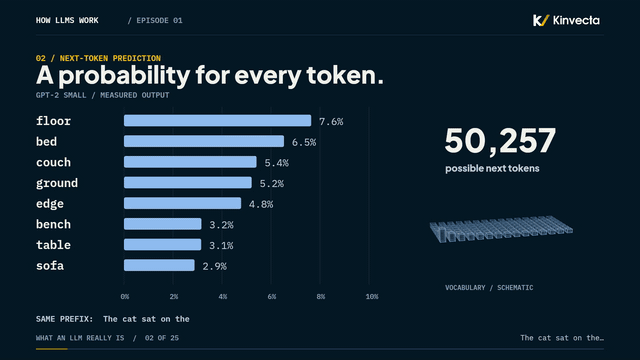
<br><sub><i>"The cat sat on the" in GPT-2 small: one probability for each of 50,257 tokens. "Mat" is rank 31 (from Episode 1).</i></sub>
</td>
</tr>
</table>

## start here

<table>
<tr>
<td width="33%" valign="top">

**Watch** (12 minutes)

Start with Episode 1, or the 4-minute trailer for the whole plan. New episodes are added to the same playlist.

[Episode 1](https://youtu.be/ZJ4BbrnXBRo) · [Episode 2](https://youtu.be/onxRHQlY-TI) · [Episode 3](https://youtu.be/RwVAxe58lqE) · [Episode 4](https://youtu.be/WAzPH6pRwUc) · [Episode 5](https://youtu.be/gYxNFd3bLk8) · [Episode 6](https://youtu.be/5emurxC67Mw) · [trailer](https://youtu.be/rXTCgq-qoJA) · [playlist](https://www.youtube.com/playlist?list=PLAw1yNagEJRM)

</td>
<td width="33%" valign="top">

**Run** (1 minute, no install)

Open the Episode 1 notebook in Colab, choose *Runtime → Run all*, and watch GPT-2 small reproduce every number in the video.

[Open in Colab](https://colab.research.google.com/github/Kinvecta/how-llms-work/blob/main/Episode%2001%20-%20What%20an%20LLM%20Really%20Is/notebook.ipynb) · [run locally](#run-the-notebooks) · [all notebooks](#course)

</td>
<td width="33%" valign="top">

**Read**

Each episode has slides as a PDF, the transcript, a research brief with every source, key terms and check questions with answers.

[Episode 1 page](Episode%2001%20-%20What%20an%20LLM%20Really%20Is/) · [syllabus](course/) · [glossary and notation](docs/glossary.md)

</td>
</tr>
</table>

## course

Episodes 1 to 6 are out, with their pages here. The notebooks for Episodes 7–16 are ready ahead of their videos, and each episode's folder (slides, transcript, research brief, page) is added here when its video is released. The full plan is in the [syllabus](course/).

| **#** | **episode** | **watch** | **notebook** | **materials** |
|:--:|---|---|---|---|
| **1** | **[What an LLM Really Is](Episode%2001%20-%20What%20an%20LLM%20Really%20Is/)**<br><sub>Part I · 12:20</sub> | [](https://youtu.be/ZJ4BbrnXBRo) | [](https://colab.research.google.com/github/Kinvecta/how-llms-work/blob/main/Episode%2001%20-%20What%20an%20LLM%20Really%20Is/notebook.ipynb) | [](Episode%2001%20-%20What%20an%20LLM%20Really%20Is/slides.pdf) [](Episode%2001%20-%20What%20an%20LLM%20Really%20Is/research-brief.md) [](Episode%2001%20-%20What%20an%20LLM%20Really%20Is/transcript/Episode%2001%20-%20What%20an%20LLM%20Really%20Is%20-%20transcript.txt) |
| **2** | **[Numbers as Geometry: Vectors](Episode%2002%20-%20Numbers%20as%20Geometry%20Vectors/)**<br><sub>Part I · 13:05 · Words as lists of numbers; dot product, length, cosine similarity</sub> | [](https://youtu.be/onxRHQlY-TI) | [](https://colab.research.google.com/github/Kinvecta/how-llms-work/blob/main/Episode%2002%20-%20Numbers%20as%20Geometry%20Vectors/notebook.ipynb) | [](Episode%2002%20-%20Numbers%20as%20Geometry%20Vectors/slides.pdf) [](Episode%2002%20-%20Numbers%20as%20Geometry%20Vectors/research-brief.md) [](Episode%2002%20-%20Numbers%20as%20Geometry%20Vectors/transcript/Episode%2002%20-%20Numbers%20as%20Geometry%20Vectors%20-%20transcript.txt) |
| **3** | **[Matrices as Machines](Episode%2003%20-%20Matrices%20as%20Machines/)**<br><sub>Part I · 15:11 · A matrix as a machine that maps vectors; the product and the shape rule; weights and biases</sub> | [](https://youtu.be/RwVAxe58lqE) | [](https://colab.research.google.com/github/Kinvecta/how-llms-work/blob/main/Episode%2003%20-%20Matrices%20as%20Machines/notebook.ipynb) | [](Episode%2003%20-%20Matrices%20as%20Machines/slides.pdf) [](Episode%2003%20-%20Matrices%20as%20Machines/research-brief.md) [](Episode%2003%20-%20Matrices%20as%20Machines/transcript/Episode%2003%20-%20Matrices%20as%20Machines%20-%20transcript.txt) |
| **4** | **[Probability, Entropy and Perplexity](Episode%2004%20-%20Probability%20Entropy%20and%20Perplexity/)**<br><sub>Part I · 18:33 · Softmax, entropy and perplexity, worked by hand; the chain rule with GPT-2's real probabilities</sub> | [](https://youtu.be/WAzPH6pRwUc) | [](https://colab.research.google.com/github/Kinvecta/how-llms-work/blob/main/Episode%2004%20-%20Probability%20Entropy%20and%20Perplexity/notebook.ipynb) | [](Episode%2004%20-%20Probability%20Entropy%20and%20Perplexity/slides.pdf) [](Episode%2004%20-%20Probability%20Entropy%20and%20Perplexity/research-brief.md) [](Episode%2004%20-%20Probability%20Entropy%20and%20Perplexity/transcript/Episode%2004%20-%20Probability%20Entropy%20and%20Perplexity%20-%20transcript.txt) |
| **5** | **[Calculus for Learning, Part 1: Derivatives and the Chain Rule](Episode%2005%20-%20Derivatives%20and%20the%20Chain%20Rule/)**<br><sub>Part I · 13:09 · A slope by hand, a three-line proof of the power rule, the chain rule and the quotient rule through softmax</sub> | [](https://youtu.be/gYxNFd3bLk8) | [](https://colab.research.google.com/github/Kinvecta/how-llms-work/blob/main/Episode%2005%20-%20Derivatives%20and%20the%20Chain%20Rule/notebook.ipynb) | [](Episode%2005%20-%20Derivatives%20and%20the%20Chain%20Rule/slides.pdf) [](Episode%2005%20-%20Derivatives%20and%20the%20Chain%20Rule/research-brief.md) [](Episode%2005%20-%20Derivatives%20and%20the%20Chain%20Rule/transcript/Episode%2005%20-%20Derivatives%20and%20the%20Chain%20Rule%20-%20transcript.txt) |
| **6** | **[Calculus for Learning, Part 2: The Gradient and the Step](Episode%2006%20-%20The%20Gradient%20and%20the%20Step/)**<br><sub>Part I · 11:31 · Partial derivatives, the gradient, why it points uphill, and why a big step can go uphill</sub> | [](https://youtu.be/5emurxC67Mw) | [](https://colab.research.google.com/github/Kinvecta/how-llms-work/blob/main/Episode%2006%20-%20The%20Gradient%20and%20the%20Step/notebook.ipynb) | [](Episode%2006%20-%20The%20Gradient%20and%20the%20Step/slides.pdf) [](Episode%2006%20-%20The%20Gradient%20and%20the%20Step/research-brief.md) [](Episode%2006%20-%20The%20Gradient%20and%20the%20Step/transcript/Episode%2006%20-%20The%20Gradient%20and%20the%20Step%20-%20transcript.txt) |
| **7** | **What Learning Means: Data, Models, Loss**<br><sub>Part II · Training data, a model with parameters, and a loss that scores it</sub> |  | [](https://colab.research.google.com/github/Kinvecta/how-llms-work/blob/main/notebooks/Episode%2007%20-%20Learning%20Loss.ipynb) [](notebooks/Episode%2007%20-%20Learning%20Loss.ipynb) | |
| **8** | **Gradient Descent: Walking Downhill**<br><sub>Part II · Following the gradient; learning rate; steps toward lower loss</sub> |  | [](https://colab.research.google.com/github/Kinvecta/how-llms-work/blob/main/notebooks/Episode%2008%20-%20Gradient%20Descent.ipynb) [](notebooks/Episode%2008%20-%20Gradient%20Descent.ipynb) | |
| **9** | **Generalization: Overfitting, Validation, Regularization**<br><sub>Part II · Practice score vs exam score; held-out data; keeping models honest</sub> |  | [](https://colab.research.google.com/github/Kinvecta/how-llms-work/blob/main/notebooks/Episode%2009%20-%20Generalization.ipynb) [](notebooks/Episode%2009%20-%20Generalization.ipynb) | |
| **10** | **Turning Text into Training Examples**<br><sub>Part II · How one page of text becomes many next-token questions</sub> |  | [](https://colab.research.google.com/github/Kinvecta/how-llms-work/blob/main/notebooks/Episode%2010%20-%20Training%20Examples.ipynb) [](notebooks/Episode%2010%20-%20Training%20Examples.ipynb) | |
| **11** | **Tokens and Embeddings**<br><sub>Part II · Byte-pair encoding and the embedding table</sub> |  | [](https://colab.research.google.com/github/Kinvecta/how-llms-work/blob/main/notebooks/Episode%2011%20-%20Tokens%20and%20Embeddings.ipynb) [](notebooks/Episode%2011%20-%20Tokens%20and%20Embeddings.ipynb) | |
| **12** | **The Artificial Neuron and Activation Functions**<br><sub>Part III · Weighted sums, biases and the bend (ReLU, GELU) that makes depth useful</sub> |  | [](https://colab.research.google.com/github/Kinvecta/how-llms-work/blob/main/notebooks/Episode%2012%20-%20Neuron%20and%20Activations.ipynb) [](notebooks/Episode%2012%20-%20Neuron%20and%20Activations.ipynb) | |
| **13** | **Deep Networks and Backpropagation**<br><sub>Part III · Layers, and how blame flows backward through them</sub> |  | [](https://colab.research.google.com/github/Kinvecta/how-llms-work/blob/main/notebooks/Episode%2013%20-%20Backpropagation.ipynb) [](notebooks/Episode%2013%20-%20Backpropagation.ipynb) | |
| **14** | **Training a Network End to End**<br><sub>Part III · Putting the pieces together: data, forward pass, loss, gradients, optimizer</sub> |  | [](https://colab.research.google.com/github/Kinvecta/how-llms-work/blob/main/notebooks/Episode%2014%20-%20Training%20End%20to%20End.ipynb) [](notebooks/Episode%2014%20-%20Training%20End%20to%20End.ipynb) | |
| **15** | **What Networks Learn: Representations**<br><sub>Part III · Probing what the hidden layers encode</sub> |  | [](https://colab.research.google.com/github/Kinvecta/how-llms-work/blob/main/notebooks/Episode%2015%20-%20Representations.ipynb) [](notebooks/Episode%2015%20-%20Representations.ipynb) | |
| **16** | **Before Transformers: Counting Words**<br><sub>Part IV · N-gram models, smoothing and what counting can and cannot do</sub> |  | [](https://colab.research.google.com/github/Kinvecta/how-llms-work/blob/main/notebooks/Episode%2016%20-%20Counting%20Words.ipynb) [](notebooks/Episode%2016%20-%20Counting%20Words.ipynb) | |
| **17–31** | **Parts IV–VI: the transformer, building and scaling, beyond the basics**<br><sub>Attention, the transformer block, a tiny GPT, pretraining, scaling laws, post-training, failure modes, evaluation</sub> |  | with each episode | [syllabus](course/) |

## how it works

The whole series hangs on one idea from Episode 1: **an LLM is a function from the text so far to a probability for every possible next token.** Everything after that explains what is inside the function, how its dials get set, and what that does and doesn't buy you.

<table>
<tr>
<td width="33%" valign="top" align="center">
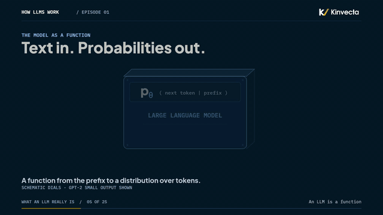
<br><b>A function with dials</b><br><sub>Text in, probabilities out. Training set the dials; using the model just reads them. <a href="Episode%2001%20-%20What%20an%20LLM%20Really%20Is/">Episode 1</a></sub>
</td>
<td width="33%" valign="top" align="center">
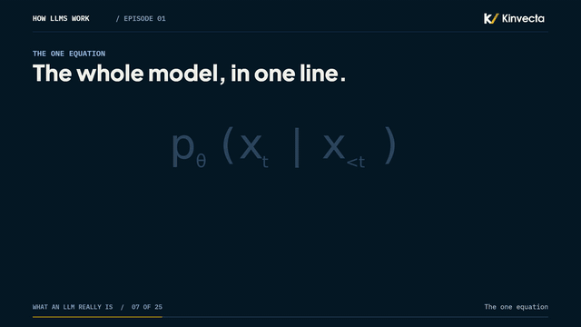
<br><b>The one equation</b><br><sub>p<sub>θ</sub>(x<sub>t</sub> | x<sub>&lt;t</sub>): the probability, by the dials θ, of token t given everything before it. <a href="Episode%2001%20-%20What%20an%20LLM%20Really%20Is/">Episode 1</a></sub>
</td>
<td width="33%" valign="top" align="center">
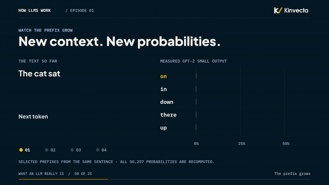
<br><b>New context, new probabilities</b><br><sub>Add one token and the whole distribution is computed again, from scratch. <a href="Episode%2001%20-%20What%20an%20LLM%20Really%20Is/">Episode 1</a></sub>
</td>
</tr>
<tr>
<td width="33%" valign="top" align="center">
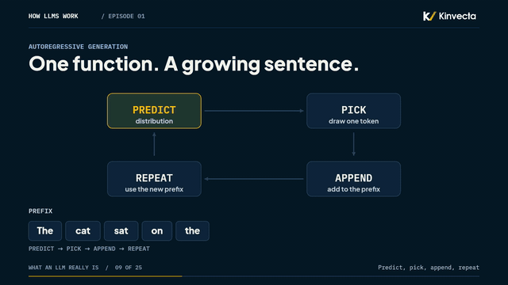
<br><b>Predict, pick, append, repeat</b><br><sub>Generation is the same equation in a loop. That's all a chatbot does when it "types". <a href="Episode%2001%20-%20What%20an%20LLM%20Really%20Is/">Episode 1</a></sub>
</td>
<td width="33%" valign="top" align="center">
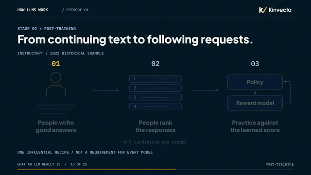
<br><b>How the dials get set</b><br><sub>Pretraining, then post-training: people write answers, rank them, and the model practices against the score. <a href="Episode%2001%20-%20What%20an%20LLM%20Really%20Is/">Episode 1</a></sub>
</td>
<td width="33%" valign="top" align="center">
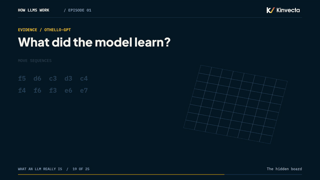
<br><b>A board it was never shown</b><br><sub>Othello-GPT learned the board from move lists alone. Evidence that prediction can build structure. <a href="Episode%2001%20-%20What%20an%20LLM%20Really%20Is/">Episode 1</a></sub>
</td>
</tr>
</table>

<p align="center">
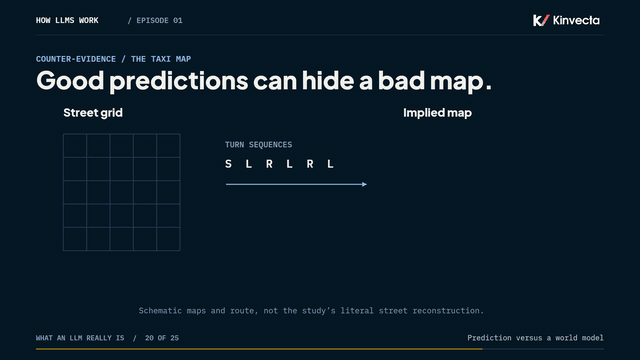
<br><sub><b>And the other side:</b> perfect next-turn predictions from a street map that doesn't exist. Strong prediction does not guarantee a coherent model of the world. <a href="Episode%2001%20-%20What%20an%20LLM%20Really%20Is/">Episode 1</a></sub>
</p>

### the series at a glance

Six parts, each built on the one before. Every episode adds one idea and keeps the notation of the ones before it.

```mermaid
flowchart LR
    P1["<b>I · Foundations</b><br/>what an LLM is<br/>vectors · matrices<br/>probability · calculus"] --> P2["<b>II · How machines learn</b><br/>loss · gradient descent<br/>generalization<br/>tokens and embeddings"]
    P2 --> P3["<b>III · Neural networks</b><br/>neurons · backprop<br/>training end to end<br/>representations"]
    P3 --> P4["<b>IV · The transformer</b><br/>n-grams · RNNs<br/>attention · the block<br/>a tiny GPT"]
    P4 --> P5["<b>V · Building and scaling</b><br/>pretraining · scaling laws<br/>training at scale<br/>post-training"]
    P5 --> P6["<b>VI · Beyond the basics</b><br/>new architectures<br/>how LLMs fail<br/>evaluation"]
    style P1 fill:#2A2A1E,stroke:#FFC400,color:#FFC400
    style P2 fill:#0F2440,stroke:#8FB4E8,color:#FFFFFF
    style P3 fill:#0F2440,stroke:#8FB4E8,color:#FFFFFF
    style P4 fill:#0F2440,stroke:#8FB4E8,color:#FFFFFF
    style P5 fill:#0F2440,stroke:#8FB4E8,color:#FFFFFF
    style P6 fill:#2E1C22,stroke:#FF4D3D,color:#FFFFFF
```

| Part | Episodes | You will be able to | Status |
|:--:|:--:|---|---|
| **I** · Foundations | 1–6 | Say what an LLM computes, and use vectors, matrices, probability, derivatives and the gradient to describe it | Eps 1–6 out |
| **II** · How machines learn | 7–11 | Define a loss, walk it downhill, check that the model generalizes, and turn text into tokens and training examples | notebooks ready |
| **III** · Neural networks | 12–15 | Build a neuron, backpropagate through a deep network, train one end to end, and probe what it learned | notebooks ready |
| **IV** · The transformer | 16–23 | Explain why counting words isn't enough, how attention works, and build a tiny GPT | notebook 16 ready |
| **V** · Building and scaling | 24–27 | Describe pretraining, scaling laws, training at scale and post-training | planned |
| **VI** · Beyond the basics | 28–31 | Weigh new architectures, LLM systems, failure modes, evaluation and governance | planned |

## one sentence, thirty episodes

> **"The cat sat on the mat because it was tired."**

The same sentence runs through every episode. In Episode 1 it's eleven GPT-2 tokens and a probability for each one. Later it becomes vectors (Episode 2), training examples (Episode 9), embeddings (Episode 10), attention ("it" looking back at "cat"), and finally text a tiny GPT generates on its own. Here is what GPT-2 small does with it today:

| prefix | next token | GPT-2 small | rank |
|---|---|--:|:--:|
| The cat sat on the | **mat** | 0.40% | 31 |
| The cat sat | **on** | 22.4% | 1 |
| The cat sat on | **the** | 45.4% | 1 |
| The cat sat on the mat because | **it** | 21.7% | 1 |
| The cat sat on the mat because it | **was** | 32.0% | 1 |
| the whole sentence, after "The" | | ≈ 1.5 × 10⁻¹⁷ | |

Every row is reproduced, and asserted, in the [Episode 1 notebook](Episode%2001%20-%20What%20an%20LLM%20Really%20Is/notebook.ipynb).

## video tutorials

Watch in order in the [YouTube playlist](https://www.youtube.com/playlist?list=PLAw1yNagEJRM). New episodes are added as they are released.

<table>
<tr>
<td width="40%"><a href="https://youtu.be/ZJ4BbrnXBRo"></a></td>
<td width="60%" valign="top">
<b><a href="https://youtu.be/ZJ4BbrnXBRo">Episode 1 · What an LLM Really Is</a></b><br>
<sub><b>Length:</b> 12:20 · <b>Part I:</b> Foundations · <a href="Episode%2001%20-%20What%20an%20LLM%20Really%20Is/">Materials&nbsp;→</a></sub>
<p>I gave a small language model five words, "The cat sat on the", and it returned a probability for every possible next token. "Mat" came in at rank 31. We open the box: learned parameters, the one function an LLM computes, the loop that turns a distribution into text, how the dials get set, and what the evidence says about memorization, internal representations and understanding.</p>
<p><b>The idea to keep:</b> <i>An LLM is a function from the text so far to a probability for every next token. Prediction is the objective; capability is what the objective rewards.</i></p>
</td>
</tr>
<tr>
<td width="40%"><a href="https://youtu.be/onxRHQlY-TI"></a></td>
<td valign="top">
<b><a href="https://youtu.be/onxRHQlY-TI">Episode 2 · Numbers as Geometry: Vectors</a></b><br>
<sub><b>Length:</b> 13:05 · <b>Part I:</b> Foundations · <a href="Episode%2002%20-%20Numbers%20as%20Geometry%20Vectors/">Materials&nbsp;→</a></sub>
<p>Three words: cat, mat, tired. Which two are more alike? A model can't look it up; it has a list of numbers for every word and one calculation. We do that calculation by hand: the dot product, the norm, cosine similarity and the scaling test that shows why we divide, then the two places it misleads you, the king − man + woman result and the "close means similar" myth.</p>
<p><b>The idea to keep:</b> <i>Cosine similarity keeps direction and drops length. It is a measuring stick, and a few large coordinates can bend it.</i></p>
</td>
</tr>
<tr>
<td width="40%"><a href="https://youtu.be/RwVAxe58lqE"></a></td>
<td valign="top">
<b><a href="https://youtu.be/RwVAxe58lqE">Episode 3 · Matrices as Machines</a></b><br>
<sub><b>Length:</b> 15:11 · <b>Part I:</b> Foundations · <a href="Episode%2003%20-%20Matrices%20as%20Machines/">Materials&nbsp;→</a></sub>
<p>Four numbers in a square move every point in the plane at once; lines stay lines and the origin stays put. That square is a matrix, and every layer of every transformer is one. We multiply matrices by hand, all four entries, learn the shape rule, write h = Wu + β, push a whole sentence through a layer in one product, and watch two linear layers collapse into one.</p>
<p><b>The idea to keep:</b> <i>A matrix is a rule that moves vectors; its columns say where the basis arrows land. A stack of linear maps is still one linear map.</i></p>
</td>
</tr>
<tr>
<td width="40%"><a href="https://youtu.be/WAzPH6pRwUc"></a></td>
<td valign="top">
<b><a href="https://youtu.be/WAzPH6pRwUc">Episode 4 · Probability, Entropy and Perplexity</a></b><br>
<sub><b>Length:</b> 18:33 · <b>Part I:</b> Foundations · <a href="Episode%2004%20-%20Probability%20Entropy%20and%20Perplexity/">Materials&nbsp;→</a> · <a href="https://youtu.be/0p3KPutSE9c">48&nbsp;s Short</a></sub>
<p>Two models finish "The cat sat on the…": one hedges, one is 97% sure. Which is more sure, and by how much? We turn that into a number, by hand: the chain rule with GPT-2's real probabilities, softmax with every exponential written out, entropy term by term for three models, and perplexity for one token, two tokens and a whole sentence (48). Then the myth: 97% sure can still mean a perplexity of 100.</p>
<p><b>The idea to keep:</b> <i>Entropy measures how spread out a prediction is; perplexity measures how surprised the model was by what actually happened. Confident is not correct.</i></p>
</td>
</tr>
<tr>
<td width="40%"><a href="https://youtu.be/gYxNFd3bLk8"></a></td>
<td valign="top">
<b><a href="https://youtu.be/gYxNFd3bLk8">Episode 5 · Calculus for Learning, Part 1: Derivatives and the Chain Rule</a></b><br>
<sub><b>Length:</b> 13:09 · <b>Part I:</b> Foundations · <a href="Episode%2005%20-%20Derivatives%20and%20the%20Chain%20Rule/">Materials&nbsp;→</a> · <a href="https://youtu.be/VlrSOMDDYk0">41&nbsp;s Short</a></sub>
<p>A hiker in fog can only feel the slope under her boots, and that is how a model learns. We find a slope the slow way (7, 6.1, 6.01), prove in three lines why z² has slope 2z, then run the calculus chain rule through a real softmax, with the quotient rule written out term by term: p(1 − p) = 0.21, and mat's surprisal falls at −0.70 per unit of score.</p>
<p><b>The idea to keep:</b> <i>A derivative is a rate of change at one point; the chain rule multiplies the effects along a chain. The slope is a local guide, not a promise for big steps.</i></p>
</td>
</tr>
<tr>
<td width="40%"><a href="https://youtu.be/5emurxC67Mw"></a></td>
<td valign="top">
<b><a href="https://youtu.be/5emurxC67Mw">Episode 6 · Calculus for Learning, Part 2: The Gradient and the Step</a></b><br>
<sub><b>Length:</b> 11:31 · <b>Part I:</b> Foundations · <a href="Episode%2006%20-%20The%20Gradient%20and%20the%20Step/">Materials&nbsp;→</a> · <a href="https://youtu.be/QMFLrOGVr0o">47&nbsp;s Short</a></sub>
<p>One step straight downhill, and you land at height 19, higher than you started. We build a gradient by hand, test slopes in three directions to see why it points steepest uphill, take a small step (3 → 1.36) and a greedy one (3 → 19), and derive 3 − 20η + 36η² to find the limit (0.556) and the best step (0.278). Then the myth: the gradient does not point to the bottom.</p>
<p><b>The idea to keep:</b> <i>The gradient tells you which way is down from here, not where the bottom is, and a step only goes down if it is small compared with the curvature.</i></p>
</td>
</tr>
<tr>
<td width="40%"><a href="https://youtu.be/rXTCgq-qoJA">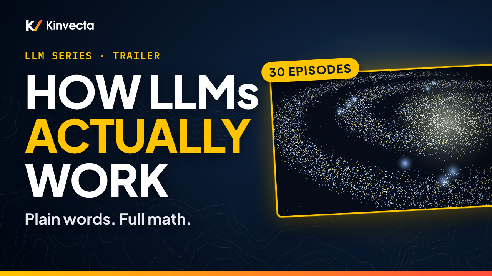</a></td>
<td width="60%" valign="top">
<b><a href="https://youtu.be/rXTCgq-qoJA">Series trailer · From Math to Transformers</a></b><br>
<sub><b>Length:</b> 3:54 · the plan for all six parts</sub>
<p>A four-minute tour of the whole series, set to an original song: next-token prediction, vectors, softmax, gradient descent, backpropagation, attention and the transformer, with one running sentence through it all.</p>
</td>
</tr>
</table>

## run the notebooks

Every notebook runs in **Google Colab** with no install: open it from the [course table](#course) and choose *Runtime → Run all*. The notebooks for Episodes 2–10 use only `numpy`; the ones that measure a real model download GPT-2 small (about 500 MB) once. A CPU is enough for all of them.

**Locally** (Python 3.12+, the same as Colab):

```bash
git clone https://github.com/Kinvecta/how-llms-work.git
cd how-llms-work
python3 -m venv .venv && source .venv/bin/activate
pip install torch --index-url https://download.pytorch.org/whl/cpu
pip install -r requirements.txt
python tools/check_notebooks.py --fast
# PASS  Episode 02 - Numbers as Geometry Vectors/notebook.ipynb  (1 s)
# ...
# 8 passed, 0 failed, 7 skipped
python tools/check_notebooks.py "Episode 01 - What an LLM Really Is/notebook.ipynb"
# PASS  Episode 01 - What an LLM Really Is/notebook.ipynb
```

`check_notebooks.py` runs each notebook top to bottom. Every number that appears in an episode is checked with an `assert`, so a pass means the code still reproduces the video. `--fast` skips the notebooks that download model weights; CI runs those weekly.

| Next step | Where |
|---|---|
| Reproduce the cold open, the prefix table and the chain rule | [Episode 1 notebook](Episode%2001%20-%20What%20an%20LLM%20Really%20Is/notebook.ipynb) |
| Change the prompt and see how sure GPT-2 is | the last cell of the Episode 1 notebook |
| Softmax and entropy by hand, with self-checks | the try-it cell of the [Episode 4 notebook](Episode%2004%20-%20Probability%20Entropy%20and%20Perplexity/notebook.ipynb) |
| Push a nudge through softmax, by hand | the try-it cell of the [Episode 5 notebook](Episode%2005%20-%20Derivatives%20and%20the%20Chain%20Rule/notebook.ipynb) |
| Run your own gradient descent and pick a step size | the try-it cell of the [Episode 6 notebook](Episode%2006%20-%20The%20Gradient%20and%20the%20Step/notebook.ipynb) |
| Get ahead: losses, MSE and cross-entropy | [Episode 7 notebook](notebooks/Episode%2007%20-%20Learning%20Loss.ipynb) |

## teach it

The episodes work as a class or a study group:

1. Watch the episode together, or assign it before class.
2. Present from the episode's `slides.pdf` and pause on the Math Lab.
3. Run the notebook live: change the prompt, change the seed, and let the class predict the output first.
4. Use the episode page's **try it** and **check your understanding** questions (answers included).

The series assumes high-school algebra and builds everything else. The [glossary](docs/glossary.md) is a handout-ready list of every term and symbol.

## FAQ

<details>
<summary><b>How much math do I need?</b></summary>

High-school algebra. Vectors, matrices, probability, logarithms and derivatives are each built in their own episode (Part I) before anything uses them. Every idea comes in plain words first; the Math Lab is there for anyone who wants the derivation.
</details>

<details>
<summary><b>Do I need a GPU or a paid account?</b></summary>

No. Every notebook runs on a CPU, in free Colab or on a laptop. The model-based notebooks use GPT-2 small (124 million parameters), which is small enough to run anywhere and open enough to inspect.
</details>

<details>
<summary><b>Why GPT-2, a 2019 model?</b></summary>

Because it is open, small and well documented, so every number in the video can be measured and reproduced by you. The ideas are the same in today's large models; the series says so when a detail differs.
</details>

<details>
<summary><b>When do the next episodes come out?</b></summary>

As they are finished. The notebooks for Episodes 7–16 are already here. Subscribe to the [playlist](https://www.youtube.com/playlist?list=PLAw1yNagEJRM) or watch this repository's releases to hear about each one.
</details>

<details>
<summary><b>Can I use it in my class?</b></summary>

Yes. The course content is CC BY 4.0, so you can present, adapt and share it with attribution. The code is MIT. See [LICENSE-CONTENT.md](LICENSE-CONTENT.md).
</details>

<details>
<summary><b>A notebook assert fails on my machine. Is the video wrong?</b></summary>

Probably not. A library update can shift a probability in the last decimal place. Check your versions against [requirements.txt](requirements.txt). If it still fails, open a [content error report](https://github.com/Kinvecta/how-llms-work/issues/new/choose) with the output.
</details>

## built with this course

Used the series in a class, a study group, or to build something? Share it in [Discussions → Show and tell](https://github.com/Kinvecta/how-llms-work/discussions/categories/show-and-tell). Please don't post secrets or anyone's personal data. The repository isn't actively maintained, so posts are read on a best-effort basis.

## more from Kinvecta

| Repository | What it is |
|---|---|
| [**Kinvecta AI Training**](https://github.com/Kinvecta/ai-training) | A free, vendor-neutral course for teams using generative AI at work: eight sessions and two deep dives, with an MCP lab. Start there if you want to *use* LLMs well; start here if you want to know how they *work*. |
| [**The Memory Layer**](https://github.com/Kinvecta/the-memory-layer) | Build an AI "second brain": linked markdown any AI tool can read, search, cite and keep current, with six videos. |

## what's inside

| Folder | What it is |
|---|---|
| [`Episode 01 - What an LLM Really Is`](Episode%2001%20-%20What%20an%20LLM%20Really%20Is/) | The episode page, slides (PDF), transcript, research brief with sources, thumbnail and the companion [notebook](Episode%2001%20-%20What%20an%20LLM%20Really%20Is/notebook.ipynb) |
| [`Episode 02 - Numbers as Geometry Vectors`](Episode%2002%20-%20Numbers%20as%20Geometry%20Vectors/) | The episode page, slides (PDF), transcript, research brief with sources, thumbnail and the companion [notebook](Episode%2002%20-%20Numbers%20as%20Geometry%20Vectors/notebook.ipynb) |
| [`Episode 03 - Matrices as Machines`](Episode%2003%20-%20Matrices%20as%20Machines/) | The episode page, slides (PDF), transcript, research brief with sources, thumbnail and the companion [notebook](Episode%2003%20-%20Matrices%20as%20Machines/notebook.ipynb) |
| [`Episode 04 - Probability Entropy and Perplexity`](Episode%2004%20-%20Probability%20Entropy%20and%20Perplexity/) | The episode page, slides (PDF), transcript, research brief with sources, thumbnail and the companion [notebook](Episode%2004%20-%20Probability%20Entropy%20and%20Perplexity/notebook.ipynb) |
| [`Episode 05 - Derivatives and the Chain Rule`](Episode%2005%20-%20Derivatives%20and%20the%20Chain%20Rule/) | The episode page, slides (PDF), transcript, research brief with sources, thumbnail and the companion [notebook](Episode%2005%20-%20Derivatives%20and%20the%20Chain%20Rule/notebook.ipynb) |
| [`Episode 06 - The Gradient and the Step`](Episode%2006%20-%20The%20Gradient%20and%20the%20Step/) | The episode page, slides (PDF), transcript, research brief with sources, thumbnail and the companion [notebook](Episode%2006%20-%20The%20Gradient%20and%20the%20Step/notebook.ipynb) |
| [`notebooks/`](notebooks/) | Companion notebooks for Episodes 7–16, ready ahead of their videos |
| [`course/`](course/) | Syllabus: all 31 episodes, six parts, outcomes |
| [`docs/`](docs/) | [Glossary and notation](docs/glossary.md) and the README's images |
| [`tools/`](tools/) | `check_notebooks.py`, which runs every notebook and its asserts |
| [`requirements.txt`](requirements.txt) | Pinned versions of everything the notebooks import |
| [`CONTRIBUTING.md`](CONTRIBUTING.md), [`SECURITY.md`](SECURITY.md), [`CITATION.cff`](CITATION.cff) | How to report an error, how to report a vulnerability, how to cite the course |

## contributing

The repository is not actively maintained, so there is no roadmap and pull requests may not get a response. If you find a wrong number, equation or claim, open a [content error report](https://github.com/Kinvecta/how-llms-work/issues/new/choose). To change or extend the material, fork the repository; the content license (CC BY 4.0) and the code license (MIT) both allow it with attribution. Details in [CONTRIBUTING.md](CONTRIBUTING.md). To cite the course, use [CITATION.cff](CITATION.cff) or the "Cite this repository" button on GitHub.

## star history

<a href="https://star-history.com/#Kinvecta/how-llms-work&Date">
  <picture>
    <source media="(prefers-color-scheme: dark)" srcset="https://api.star-history.com/svg?repos=Kinvecta/how-llms-work&type=Date&theme=dark">
    
  </picture>
</a>

## maintenance and security

This repository accompanies the videos. Episodes are added as they are released, but it is **not actively maintained** beyond that:

- **Content can go stale.** Research findings, model names and benchmark numbers reflect the time of recording. Each research brief lists its sources so you can check them.
- **Dependencies can go stale.** `requirements.txt` pins the versions the notebooks were checked with. They are not kept current and may come to include published vulnerabilities. Update them and run your own scans (for example `pip-audit`) before you reuse the code.
- **Pull requests and issues may not get a response.** Fork the repository if you need changes.
- **The notebooks download public model weights** from the Hugging Face Hub. Load weights only from sources you trust.

Automated checks run on GitHub Actions: the notebooks on Python 3.12 and 3.13 (the model-download notebooks weekly), a secret scan of the full history (Gitleaks), a dependency audit (`pip-audit`), CodeQL code scanning, and Dependabot alerts. Passing checks lower the risk but do not prove the code is secure. To report a vulnerability, see [SECURITY.md](SECURITY.md).

## license

- **Code** (the notebooks' code cells and `tools/`): [MIT](LICENSE)
- **Course content** (slides, transcripts, episode pages, research briefs, syllabus, glossary, notebook text, README images): [CC BY 4.0](LICENSE-CONTENT.md)

© 2026 Mark D. Espinoza / Kinvecta.

<br>

<p align="center">
  <a href="https://www.youtube.com/playlist?list=PLAw1yNagEJRM">&nbsp;</a>
  <a href="https://kinvecta.ai">&nbsp;</a>
  <a href="course/">&nbsp;</a>
  <a href="https://colab.research.google.com/github/Kinvecta/how-llms-work/blob/main/Episode%2001%20-%20What%20an%20LLM%20Really%20Is/notebook.ipynb">&nbsp;</a>
  <a href="Episode%2001%20-%20What%20an%20LLM%20Really%20Is/research-brief.md">&nbsp;</a>
</p>
<p align="center"><sub>If this helped, a star helps others find it.</sub></p>
<p align="center"><sub>Built by <a href="https://kinvecta.ai">Kinvecta</a> · AI training in plain words, with the math made visible</sub></p>
